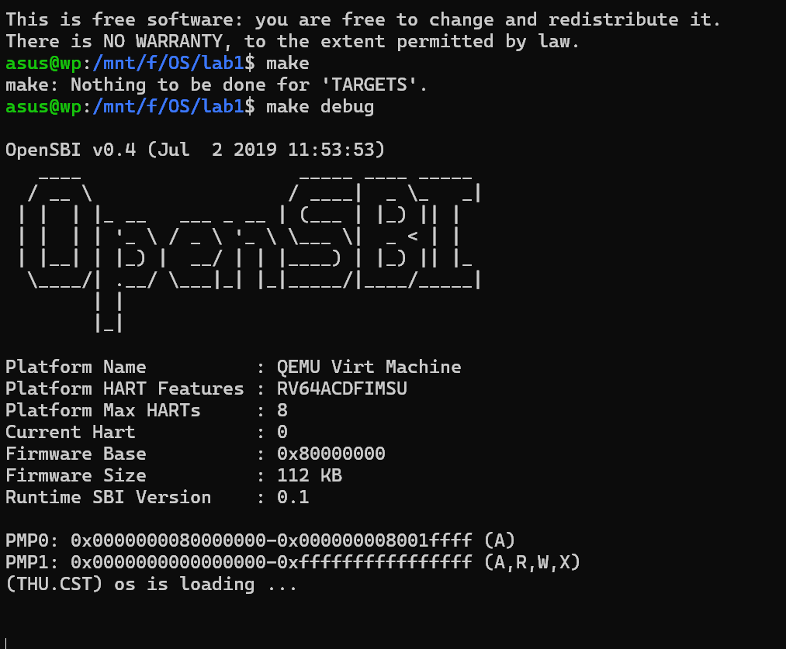
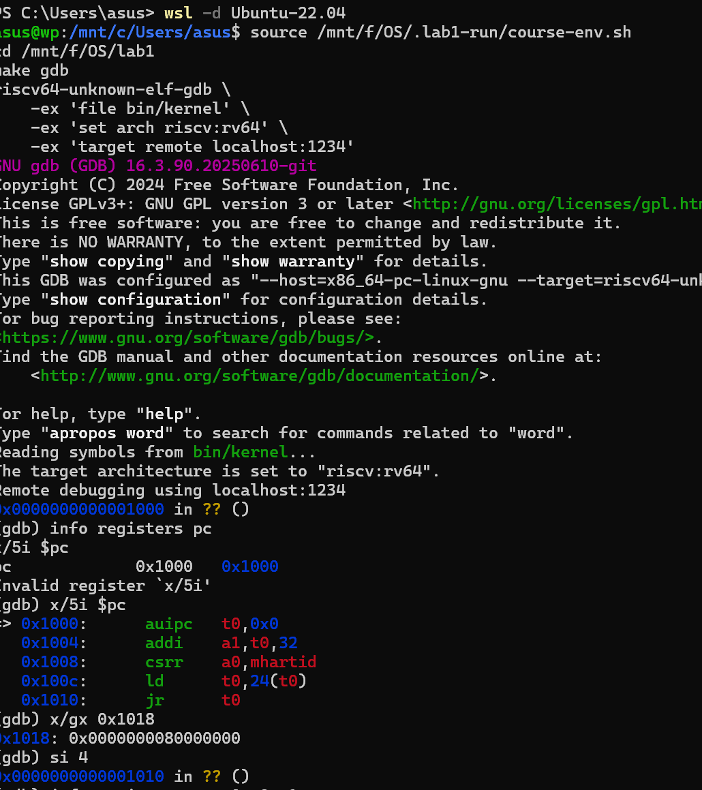
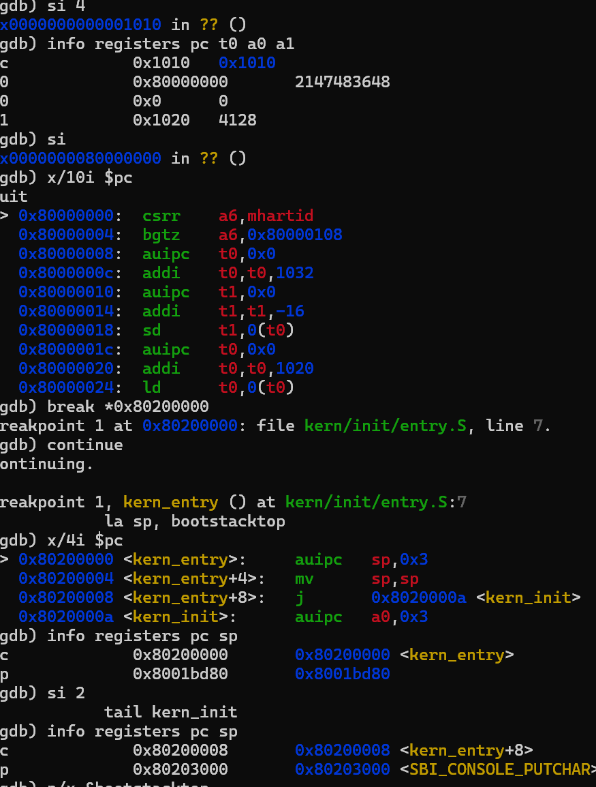
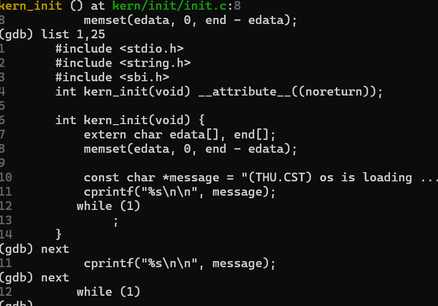
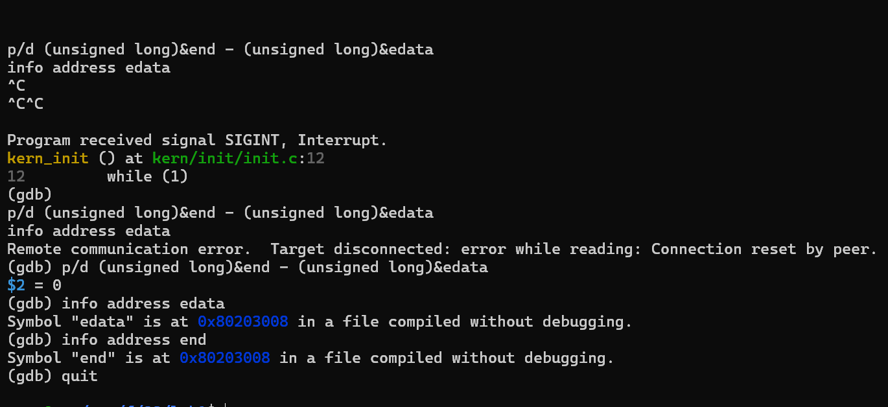
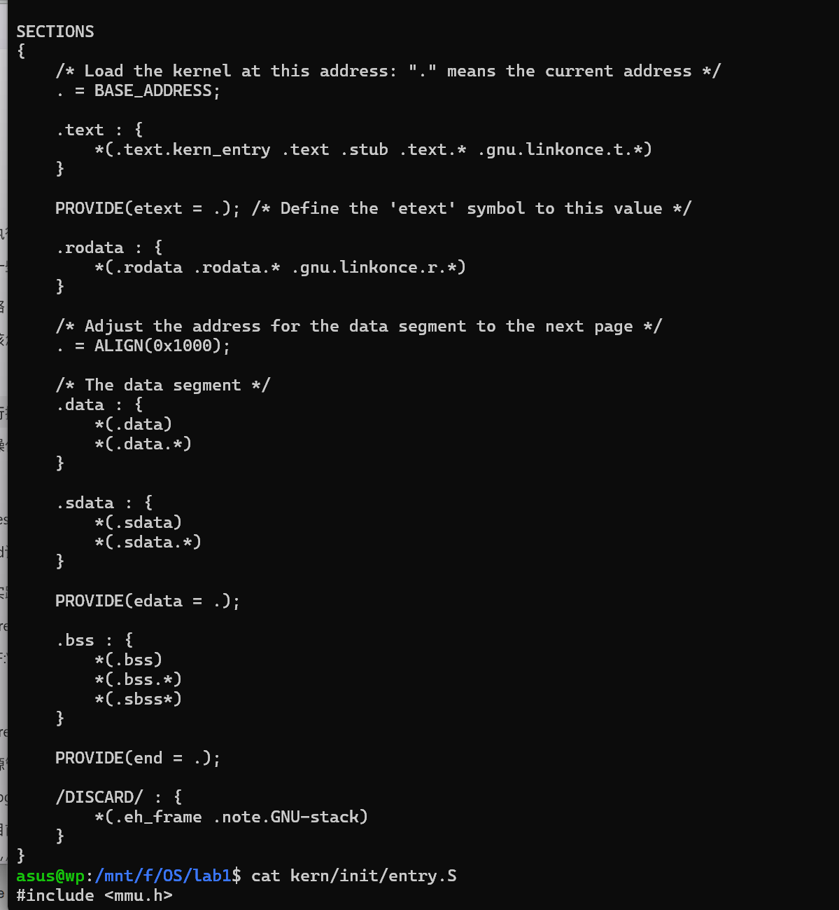
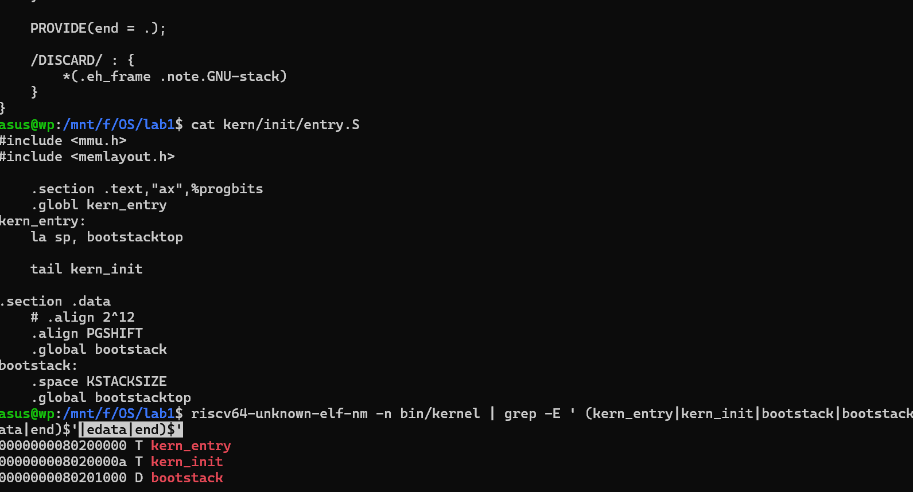

# 操作系统实验报告

## 实验基本信息

| 项目 | 内容 |
|------|------|
| **实验名称** | Lab1：比麻雀更小的麻雀（最小可执行内核） |
| **小组成员** | 2414006—王璞 |
| **完成日期** | 2026-10-10 |

### 小组分工

| 学号 | 姓名 | 负责的练习／模块 | 报告分工 |
|------|------|-----------------|----------|
| 2414006 | 王璞 | 本次环境确认、练习1分析、练习2启动追踪与结果记录 | 本次实验过程、练习解答与总结整理 |
| | | | |
| | | | |

---

## 一、实验目的

我通过运行和调试已有的最小 uCore 内核，理解从 CPU 复位到内核开始执行的过程。本次实验的目标是：

1. 理解复位入口、OpenSBI、内核汇编入口与 C 初始化函数之间的关系。
2. 理解 `la sp, bootstacktop` 和 `tail kern_init` 的作用，以及进入 C 代码之前设置内核栈的必要性。
3. 掌握 QEMU 与 GDB 配合使用的方法，能够查看寄存器、反汇编指令、读取内存、单步执行和设置断点。
4. 将源代码、链接脚本与实际地址对应起来，用调试结果验证对启动流程的理解。
5. 在 AI 的逐步指导下执行实验，保留实际输入、输出和错误反馈，并根据实测结果修正分析。

---

## 二、实验环境

### 2.1 软件与工具

| 项目 | 本次使用的环境 |
|------|----------------|
| 宿主系统 | Windows，使用 PowerShell 启动 WSL |
| Linux 环境 | Ubuntu 22.04.5 LTS，WSL 2 运行模式 |
| WSL 软件版本 | 3.0.1.0 |
| QEMU | 4.1.1，模拟 RISC-V 64 位 `virt` 平台 |
| 固件 | OpenSBI v0.4，运行时 SBI 版本 0.1 |
| 交叉编译器 | `riscv64-unknown-elf-gcc` 15.1.0 |
| 调试器 | `riscv64-unknown-elf-gdb` 16.3.90.20250610-git |
| 构建工具 | GNU Make 4.3 |
| Windows 代码目录 | `F:\OS\lab1` |
| WSL 代码目录 | `/mnt/f/OS/lab1` |

在每个实验终端中，我都执行了以下命令，使当前终端使用指定的 QEMU 与 RISC-V 工具链：

```bash
source /mnt/f/OS/.lab1-run/course-env.sh
cd /mnt/f/OS/lab1
```

其中，环境脚本设置了 QEMU 路径、`PATH` 和 `LD_LIBRARY_PATH`。`source` 会在当前 Shell 中执行脚本，因此新开的终端需要重新加载。

提交仓库时，我将同一份环境脚本放入了 [code/tools/course-env.sh](../code/tools/course-env.sh)。复现实验时可进入仓库的 `code` 目录，执行 `source tools/course-env.sh`，再使用 `make`、`make debug` 和 `make gdb`；工具安装位置不同的机器需要先调整脚本中的路径。

### 2.2 AI 工具

| 学号 | 姓名 | AI 编程工具 | 底层模型 | 使用方式 |
|------|------|-------------|----------|----------|
| 2414006 | 王璞 | Codex 桌面应用 | GPT-6.1 Sol（`gpt-6.1-sol`） | 分步骤指导、解释命令、分析实际输出及辅助整理报告 |
| | | | | |
| | | | | |

我将实验操作与辅助讨论分开进行。实验操作对话按“给出一个步骤—我执行并反馈—AI 分析后继续”的方式推进，其原始交互记录见 [prompt.md](./prompt.md)。本报告在 AI 辅助下依据实际输出整理，供我审阅核对。

---

## 三、实验整体逻辑分析

### 3.1 本章节的逻辑主线

我理解本章的主线是：先准备内核镜像与调试环境，再观察 CPU 如何从复位入口经过固件进入内核，最后理解内核如何建立自己的运行环境并执行 C 代码。

本次实际观察到的执行顺序如下：

```text
复位 ROM：0x1000
    ↓ 设置参数并读取跳转目标
OpenSBI：0x80000000
    ↓ 完成固件初始化并移交控制权
kern_entry：0x80200000
    ↓ 设置内核栈，跳转到 C 初始化函数
kern_init：0x8020000a
    ↓ 调用 memset、输出启动信息
while (1)：保持内核运行
```

这些地址属于本次 QEMU 4.1.1 `virt` 平台及内核链接结果，不能直接视为所有 RISC-V 机器的固定启动地址。

### 3.2 功能的逐步实现与执行

本次练习以理解和验证已有代码为主，我没有新增内核功能。各阶段的依赖关系是：

1. **构建与加载准备。** Makefile 将源代码编译、链接为 `bin/kernel`，再生成原始镜像 `bin/ucore.img`。前者提供 GDB 所需的符号与调试信息，后者供 QEMU 加载。
2. **复位入口执行。** CPU 从 `0x1000` 开始执行复位代码，准备硬件线程编号和设备树地址，并跳转到 OpenSBI。
3. **固件初始化。** OpenSBI 完成后续初始化，将控制权交给 `0x80200000` 处的内核入口。
4. **内核栈建立。** `kern_entry` 先设置 `sp`，为执行 C 函数和后续函数调用提供可用的栈。
5. **C 初始化和输出。** `kern_init` 调用 `memset` 处理 BSS 区域，随后通过 `cprintf` 输出启动信息，最后进入无限循环。

我还阅读了输出相关的代码，理解到控制台输出经过以下调用关系：

```text
cprintf → vcprintf → vprintfmt → cputch
        → cons_putc → sbi_console_putchar → sbi_call → ecall
```

`vprintfmt` 负责格式化，`cputch` 将字符交给控制台接口，`sbi_call` 通过 `ecall` 请求固件服务。这是基于源码的分析；本次没有逐层单步跟踪整条输出调用链。

---

## 四、实验内容与实现

### 4.1 练习1：理解内核启动中的程序入口操作

**负责人：** 2414006—王璞

#### 相关代码与模块

我阅读了 `kern/init/entry.S`，内核汇编入口的关键代码是：

```asm
kern_entry:
    la sp, bootstacktop
    tail kern_init
```

其后在 `.data` 段中定义了内核启动栈：

```asm
.section .data
    .align PGSHIFT
    .global bootstack
bootstack:
    .space KSTACKSIZE
    .global bootstacktop
bootstacktop:
```

相关 C 函数声明为：

```c
int kern_init(void) __attribute__((noreturn));
```

`kern_entry` 是汇编入口标签，负责建立进入 C 代码所需的栈；`kern_init` 负责最小内核的 C 初始化。

#### `la sp, bootstacktop` 的操作与目的

`la` 是加载地址的伪指令。这条指令将符号 `bootstacktop` 的地址放入栈指针寄存器 `sp`，并不是读取栈顶位置存储的数据。

我查询到：

```text
bootstack    = 0x80201000
bootstacktop = 0x80203000
```

因此，栈空间为 `[0x80201000, 0x80203000)`，大小是 `0x2000`，即 8192 字节。栈向低地址增长，所以初始 `sp` 设置在这段空间的上边界。代码中的 `.align PGSHIFT` 将栈起点按 4096 字节对齐。

在 GDB 中，我进入 `kern_entry` 时观察到 `sp = 0x8001bd80`。执行 `la` 对应的两条机器指令后，`sp` 变为 `0x80203000`，与 `&bootstacktop` 一致，说明内核已经使用自己的启动栈。

寄存器输出还将该数值标为 `<SBI_CONSOLE_PUTCHAR>`。我通过 `p/x &bootstacktop` 核对了栈顶的实际地址，确认同样是 `0x80203000`；地址旁显示的符号名称不改变寄存器的数值。

设置栈的目的是为 C 函数的局部变量、寄存器保存和函数调用提供内存空间。若没有先设置有效的栈，后续 C 代码使用栈时就可能访问不适当的地址，导致内核无法正常执行。

#### `tail kern_init` 的操作与目的

`tail` 是尾调用伪指令，它跳转到 `kern_init`，不为这次跳转写入新的返回地址。在这里，`kern_init` 被声明为不返回，并在最后进入 `while (1)`，所以汇编入口可以直接把控制权交给它。

我观察到本次链接后的入口指令为：

```text
0x80200000 <kern_entry>:   auipc sp,0x3
0x80200004 <kern_entry+4>: mv    sp,sp
0x80200008 <kern_entry+8>: j     0x8020000a <kern_init>
```

这说明源代码中的伪指令与最终机器指令不一定一一对应。`la` 在本次结果中对应前两条指令，`tail` 最终被缩短为直接跳转。执行该跳转后，我在 GDB 中进入 `kern_init`，看到当前源码行为 `memset(edata, 0, end - edata)`。

因此，我对这两条指令的理解是：先准备内核自己的栈，再从汇编启动阶段进入 C 初始化阶段。

#### C 初始化的补充观察

`kern_init` 的主要操作为：

```c
extern char edata[], end[];
memset(edata, 0, end - edata);

const char *message = "(THU.CST) os is loading ...\n";
cprintf("%s\n\n", message);

while (1)
    ;
```

我结合 `tools/kernel.ld` 理解到，`edata` 与 `end` 分别标记 BSS 前后的边界。本次查询结果为：

```text
edata = 0x80203008
end   = 0x80203008
end - edata = 0
```

因此，本次确实调用了 `memset`，但清零长度是 0，不能描述为实际清零了一段非空内存。启动栈位于 `.data` 段，也不属于这个清零区间。

### 4.2 练习2：使用 GDB 验证启动流程

**负责人：** 2414006—王璞

#### 调试准备与启动方式

我在代码目录执行了 `make`，得到：

```text
make: Nothing to be done for 'TARGETS'.
```

这表示已有构建产物满足 Makefile 的依赖与时间戳检查，本次无需重新构建。之后，我在第一个 Ubuntu 终端运行 `make debug`，在第二个终端加载相同环境并运行 `make gdb`。

Makefile 的调试参数包括：

```text
-machine virt
-nographic
-bios default
-device loader,file=bin/ucore.img,addr=0x80200000
-s -S
```

`-s` 开启默认端口为 1234 的 GDB 服务，`-S` 使 CPU 在执行第一条指令之前暂停。GDB 使用 `bin/kernel` 的符号信息连接 QEMU，因此我能够从复位入口开始观察，而不是在内核已经运行后才连接。

#### 从复位入口到 OpenSBI

连接成功后，GDB 显示 `0x0000000000001000 in ?? ()`。我通过以下命令查看 PC 和最初五条指令：

```gdb
info registers pc
x/5i $pc
```

得到的指令及其作用如下：

| 地址 | 指令 | 我的理解 |
|------|------|----------|
| `0x1000` | `auipc t0,0x0` | 将当前指令地址 `0x1000` 放入 `t0`。 |
| `0x1004` | `addi a1,t0,32` | 得到 `a1 = 0x1020`，指向复位 ROM 中的设备树，作为后续阶段的参数。 |
| `0x1008` | `csrr a0,mhartid` | 读取当前硬件线程编号并放入 `a0`；本次编号为 0。 |
| `0x100c` | `ld t0,24(t0)` | 从 `0x1018` 读取 64 位跳转目标，放入 `t0`。 |
| `0x1010` | `jr t0` | 跳转到 `t0` 保存的地址，即本次 OpenSBI 入口。 |

我执行 `x/gx 0x1018`，确认该地址存储的是 `0x0000000080000000`。随后使用 `si 4` 执行跳转前的四条指令，并检查寄存器：

```text
pc = 0x1010
t0 = 0x80000000
a0 = 0x0
a1 = 0x1020
```

再执行一次 `si`，CPU 进入 `0x80000000`。我使用 `x/10i $pc` 查看该位置的代码，最初指令为 `csrr a6,mhartid`。

由此，我确认：本次模拟平台加电复位后，最初执行的几条指令位于 `0x1000` 开始的复位 ROM 中。它们主要准备启动参数、读取下一阶段入口并跳转到 OpenSBI；OpenSBI 自身的入口位于 `0x80000000`。

固件地址处显示 `??`，是因为 GDB 当前加载的是 uCore 的符号信息，不能将固件地址解析为对应的函数名，并不表示 CPU 执行出错。

#### 从 OpenSBI 到内核第一条指令

为了越过大量固件初始化代码，我在内核入口设置断点并继续执行：

```gdb
break *0x80200000
continue
```

随后 GDB 停在：

```text
Breakpoint 1, kern_entry () at kern/init/entry.S:7
7           la sp, bootstacktop
```

我查询 PC 和反汇编结果，确认 PC 为 `0x80200000`，下一条将执行的指令是 `auipc sp,0x3`。这验证了控制权已经到达内核入口，并在内核第一条指令执行之前暂停。

与此同时，QEMU 终端输出了 OpenSBI v0.4 的启动信息，其中 `Firmware Base` 为 `0x80000000`。我在后续单步执行中又观察到栈指针设置、进入 `kern_init`，以及以下内核启动输出：

```text
(THU.CST) os is loading ...
```

本次我单步跟踪了复位 ROM 的五条指令，通过断点观察了 OpenSBI 到内核的交接结果，没有逐条跟踪 OpenSBI 内部全部初始化指令，也没有直接验证其最后交接时的特权寄存器变化。

#### 关于题目提示中“内核加载”的理解

我结合本次 Makefile 的参数分析发现，`bin/ucore.img` 是由 QEMU 的 `loader` 设备在启动时预先放入 `0x80200000`，之后 OpenSBI 将控制权交给这个地址。

因此，在本实验配置中，内核镜像的预加载与 CPU 执行固件是两个需要区分的过程。我没有使用 `watch *0x80200000`，也没有观察到 OpenSBI 将镜像写入该地址的过程。连接已经暂停的 QEMU 后再设置观察点，不能据此证明此前由 QEMU 完成的预加载。

### 4.3 提示词与实际迭代过程

本次没有需要 AI 编写的新增内核函数，因此我没有把实验描述为经过若干轮代码生成后实现内核。AI 协作主要围绕操作指导、结果解释和调试问题处理展开。

我最初使用的提示词原文是：

```text
我正在做操作系统 Lab1：使用 GDB 观察 RISC-V 从复位入口、OpenSBI 到 uCore 内核的启动过程。

当前代码目录是 F:\OS\lab1。
已安装 Ubuntu-22.04（WSL）、QEMU 4.1.1 和 RISC-V 工具链。
实验环境脚本是 /mnt/f/OS/.lab1-run/course-env.sh。

请作为实验助手一步一步指导我。每次给出一个小步骤，解释命令的作用和预期结果；我执行并提供实际输出后，你再分析并继续。

现在从第一步开始：指导我进入 Ubuntu，加载实验环境，确认代码路径及 QEMU、编译器和 Make 的版本。
```

后续我逐步提交实际输出，完整原文及 AI 回复保存在 [prompt.md](./prompt.md)，没有重新编造一条“最终成功提示词”。实际问题处理过程如下：

| 问题 | 我的反馈与处理 | 结果与认识 |
|------|----------------|------------|
| 两条 GDB 命令被合并 | 反馈 ``Invalid register `x/5i'``，随后单独执行 `x/5i $pc`。 | 正常显示复位指令。我认识到粘贴命令时应确认每条命令单独提交。 |
| 输出中出现 `quit`，AI 判断我可能想退出 | 我说明“quit是输出不是我输入的”。 | AI 继续实验。这让我意识到反馈时要标明输入、输出及自己的说明。 |
| GDB 在无限循环附近没有返回提示符 | 我反馈无输出，并按指导检查进程、尝试中断。 | 一次 SIGINT 使 GDB 停在 `while (1)`；后续查询又出现延迟，最终结束当次 QEMU 后恢复命令状态。具体原因未完全确认。 |
| 通过 WSL 查询进程时命令解析出错 | 我反馈 `qemu-system-riscv64: command not found`，随后改用 `--exec`，分别查询 GDB 和 QEMU。 | 找到当次调试进程，完成后续收尾。 |
| BSS 清零结果需要核实 | 我查询 `edata`、`end` 及其差值。 | 实测差值为 0，修正了笼统描述为“清零 BSS”的说法。 |
| 粘贴源码时漏掉最后一个标签 | AI 核对文件末尾，确认仍有 `bootstacktop:`。 | 文件本身完整，遗漏发生在反馈内容中。 |

最终，我退出了 QEMU 和 GDB，并保存了本次观察记录。

---

## 五、测试与验证

### 5.1 实测结果汇总

| 验证项 | 实际结果 | 判断依据 |
|--------|----------|----------|
| 工具版本 | QEMU 4.1.1、GCC 15.1.0、GDB 16.3.90.20250610-git、Make 4.3 | 各工具的版本命令输出。 |
| 构建检查 | `make` 提示 `Nothing to be done for 'TARGETS'.` | 当前已有构建产物无需重新构建。 |
| 复位地址 | `PC = 0x1000` | GDB 连接后的暂停位置与寄存器查询。 |
| 首次跳转目标 | `0x1018` 中保存 `0x80000000` | 内存读取及单步后的 `t0`。 |
| OpenSBI 入口 | `PC = 0x80000000` | 执行复位跳转后查看指令。 |
| 内核入口 | `PC = 0x80200000`，对应 `kern_entry` | 命中内核入口断点。 |
| 内核栈 | `sp` 从 `0x8001bd80` 变为 `0x80203000` | 单步执行 `la` 前后的寄存器值。 |
| 栈大小 | 8192 字节 | `bootstacktop - bootstack = 0x2000`。 |
| C 初始化入口 | `kern_init = 0x8020000a` | 单步结果及 ELF 符号表。 |
| BSS 清零长度 | 0 字节 | `edata = end = 0x80203008`。 |
| 启动输出 | `(THU.CST) os is loading ...` | QEMU 终端实际输出。 |

我还使用 `riscv64-unknown-elf-nm` 核对了关键符号：

```text
0000000080200000 T kern_entry
000000008020000a T kern_init
0000000080201000 D bootstack
0000000080203000 D bootstacktop
0000000080203008 D edata
0000000080203008 D end
```

这些结果与 GDB 观察一致。

### 5.2 验证范围

本次验证覆盖了题目要求的启动地址、复位指令作用、内核入口交接和栈初始化。启动输出来自 `make debug` 的 QEMU 会话。

本次操作对话没有独立执行 `make qemu` 的记录；当前源码目录也缺少 Makefile 中 `make grade` 调用的 `tools/grade.sh`，因此本报告不将自动评分描述为通过。正式练习的验证依据是上述 GDB 追踪结果和内核实际输出。

### 5.3 测试截图

我从本次保存的终端截图中选取了以下七张，分别展示实际运行结果、启动追踪和问题处理。图片保存在 `images/` 中。

| 图号 | 截图内容 | 文件名 |
|------|----------|--------|
| 图1 | `make` 检查、OpenSBI 信息与内核启动输出 | `build_kernel_output.png` |
| 图2 | GDB 连接、复位 PC、最初五条指令与跳转目标 | `reset_entry.png` |
| 图3 | 进入 OpenSBI、命中内核入口断点与栈指针变化 | `startup_kernel_stack.png` |
| 图4 | 进入 `kern_init` 并单步执行 C 初始化代码 | `kern_init_steps.png` |
| 图5 | 调试连接结束后查询 BSS 边界，确认清零长度为 0 | `gdb_recovery_bss.png` |
| 图6 | 链接脚本中的代码段、数据段与 BSS 布局 | `linker_layout.png` |
| 图7 | 内核入口源码与部分符号表输出 | `entry_source_symbols.png` |

**图1：构建检查与启动输出。** `make` 提示现有目标无需重新构建；随后通过 `make debug` 运行的 QEMU 输出 OpenSBI 信息和内核启动消息。



**图2：复位入口。** GDB 连接后 PC 为 `0x1000`；单独执行反汇编命令后显示最初五条指令，读取 `0x1018` 得到下一阶段入口 `0x80000000`。图中同时保留了合并输入命令造成的错误。



**图3：启动交接与栈初始化。** 单步跳转到 `0x80000000` 后，在 `0x80200000` 设置断点并继续运行，命中 `kern_entry`。执行 `si 2` 后，`sp` 从 `0x8001bd80` 变为 `0x80203000`。



**图4：C 初始化。** 跳转到 `kern_init` 后，GDB 显示其源码。继续按源码行执行，依次到达 `cprintf` 和 `while (1)`。



**图5：调试问题收尾与 BSS 核实。** 图中保留了中断、连接断开和随后处理查询命令的输出；`edata`、`end` 均为 `0x80203008`，差值为 0。



**图6：链接脚本。** 脚本安排 `.text`、`.rodata`、`.data`、`.sdata` 和 `.bss`，并定义 `edata` 与 `end`，帮助我理解实测的内存边界。



**图7：入口源码与符号查询。** 截图记录了 `la sp, bootstacktop`、`tail kern_init` 和栈空间定义，以及 `nm` 输出中的部分关键符号。完整的符号查询文字记录见第 5.1 节和 `prompt.md`。



---

## 六、实验总结与收获

### 6.1 对操作系统的理解

通过这次实验，我把“启动操作系统”理解为多个阶段的控制权交接。复位代码负责进入固件，固件负责完成初始化并进入内核，内核汇编入口负责准备栈，之后才开始执行 C 初始化函数。

我认为本实验的重要知识点及其与 OS 原理的联系如下：

| 实验知识点 | 对应的 OS 原理 | 含义、关系与差异 |
|------------|----------------|------------------|
| 复位入口与启动链 | 系统引导、固件与操作系统的分工 | 实验展示了从复位 ROM 经 OpenSBI 到内核的交接；真实系统还可能涉及磁盘引导程序、设备探测与安全检查。 |
| 内核栈初始化 | 运行上下文、函数调用与栈 | `sp` 指向内核栈，支持 C 函数执行；本次只有启动栈，没有进一步实现进程独立的内核栈及上下文切换。 |
| 链接脚本与段布局 | 程序装入、代码段／数据段／BSS | 链接脚本给符号和段安排地址，启动代码建立必要的初始状态；本次为固定布局，没有展开动态装入或地址空间管理。 |
| SBI 控制台输出 | 特权层次、异常与底层服务接口 | 源码通过 `ecall` 请求 SBI 服务；这里是内核与固件之间的接口，没有实现用户程序向内核发起系统调用的完整机制。 |
| PC、单步与断点 | 指令执行与控制流 | 调试将源码中的控制流对应到实际机器指令；伪指令经过汇编与链接后可能变成不同数量的机器指令。 |

本实验还没有对应实现的重要 OS 原理内容包括：

1. **进程与线程管理：** 进程创建、调度、上下文切换和退出。
2. **虚拟内存管理：** 页表建立、地址转换、缺页处理和页面置换。
3. **中断与并发：** 时钟中断、同步互斥、竞争条件和死锁处理。
4. **文件系统与持久化：** 文件、目录、磁盘空间管理和设备驱动。
5. **用户态运行与保护：** 用户程序装入、系统调用接口和不同进程之间的隔离。

因此，启动输出只说明这个最小内核已经运行到相应位置，不能据此认为它已经具有上述完整操作系统功能。

### 6.2 AI 协作开发的经验

我在本次实验中最直接的体会是，分步骤反馈实际结果能够及时发现理解和操作上的偏差。例如，合并命令造成的错误、输出中的 `quit`、遗漏的源码末行，都需要结合真实反馈继续判断。

我也认识到，AI 给出的预期结果需要通过实验核实。`memset` 是一个典型例子：从代码上看它用于清零 BSS，但本次查询得到的长度是 0，报告必须采用这个实际结果。

以后我会在反馈时分别标明“执行的命令”“实际输出”和“我遇到的问题”，并在关键阶段保存截图。对于尚未确认的问题，例如本次 GDB 的延迟响应，我会记录现象与处理过程，而不把推测当作确定原因。

---

## 参考资料

1. [Lab1 正式练习要求](http://oslab.mobisys.top/lab2026/_book/lab1/lab1_2_1_exercise.html)。
2. [Lab1 实验报告要求](http://oslab.mobisys.top/lab2026/_book/lab1/lab1_5_requirement.html)。
3. 课程提供的 `kern/init/entry.S`、`kern/init/init.c`、`tools/kernel.ld`、`Makefile` 及输出相关源代码。
4. [RISC-V 汇编手册：伪指令说明](https://github.com/riscv-non-isa/riscv-asm-manual/blob/main/src/asm-manual.adoc)。
5. [QEMU Generic Loader 文档](https://www.qemu.org/docs/master/system/generic-loader.html)。
6. [QEMU 4.1.1：RISC-V virt 平台源码](https://github.com/qemu/qemu/blob/v4.1.1/hw/riscv/virt.c)。
7. 本次实验操作对话原文与本地观察记录。
