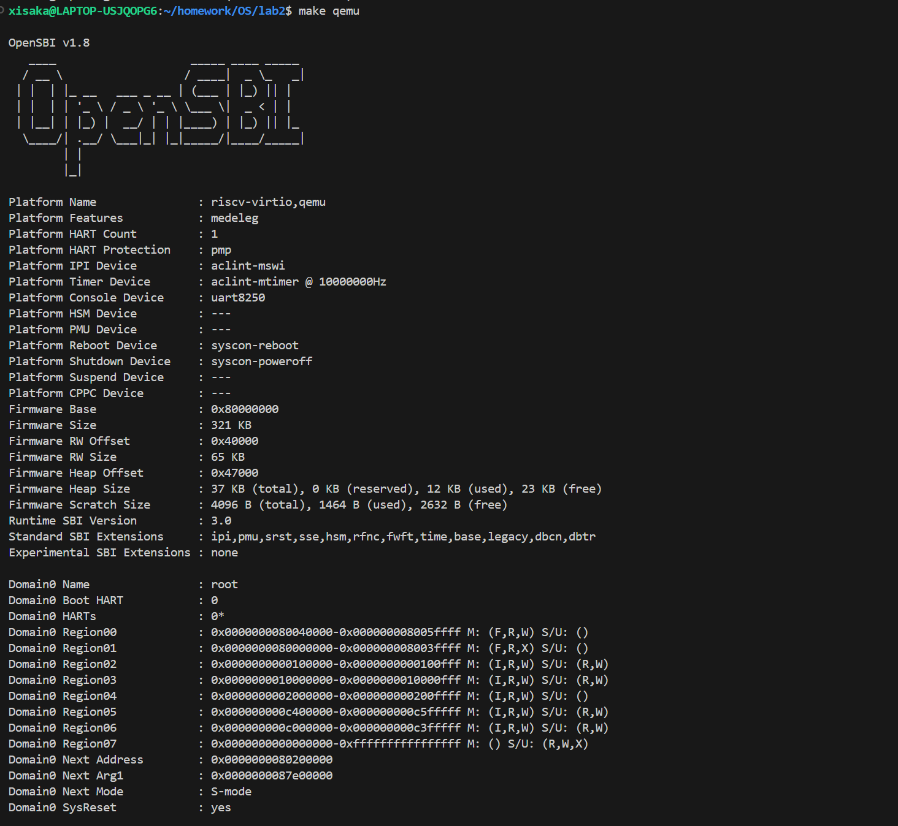
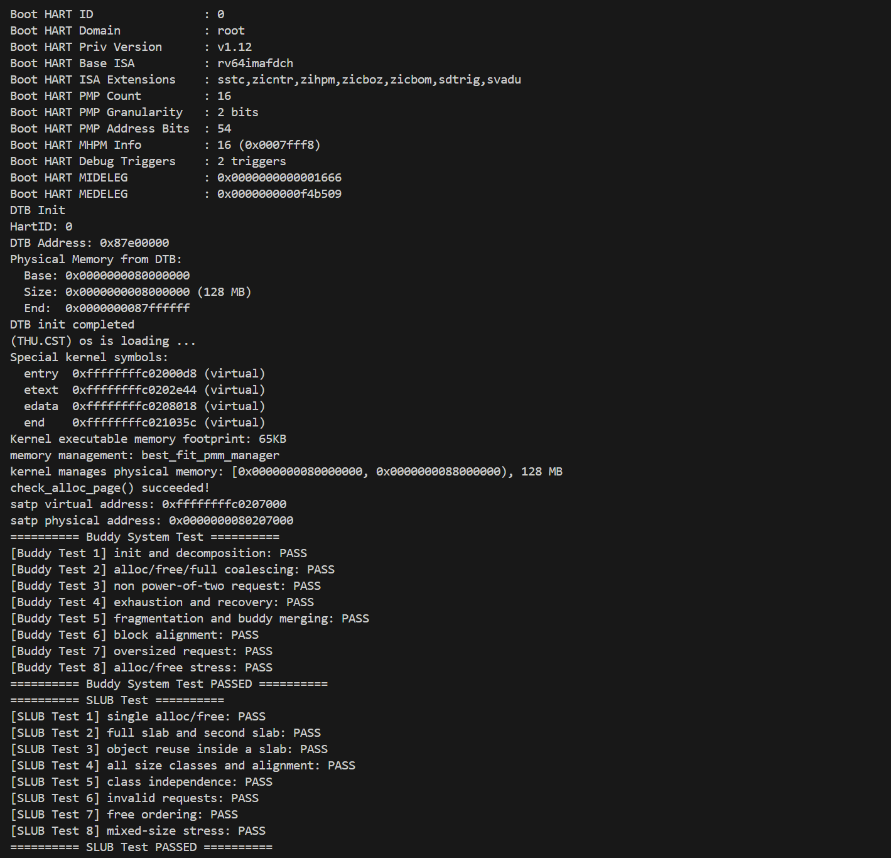
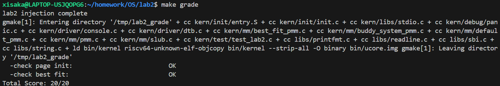
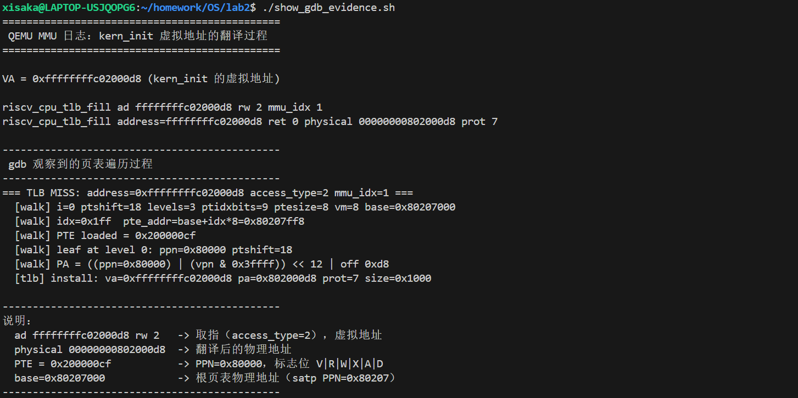

# 操作系统实验报告

## 实验基本信息

| 项目 | 内容 |
|------|------|
| **实验名称** | Lab2：物理内存和页表 |
| **小组成员** | 2414006-王璞、2412953-裴家昌、2414107-李易洲 |
| **完成日期** | 2026-10-21 |
| **修订日期** | 2026-10-23 |

### 小组分工

**练习如何分工？**

| 成员 | 负责的练习/模块 |
|------|----------------|
| 2412953-裴家昌 | 功能模块一·任务一（`page_init`）、功能模块二·任务二（Best-Fit）、整体集成与评分测试 |
| 2414006-王璞 | 功能模块二·任务三（Buddy System）、QEMU 版本适配 |
| 2414107-李易洲 | Challenge（SLUB）、分支任务（双 GDB 调试 QEMU 页表翻译） |

**实验报告如何分工？**

| 成员 | 负责的报告章节 |
|------|----------------|
| 2412953-裴家昌 | 第一、二、三章；功能模块一、Best-Fit、思考题部分；统稿 |
| 2414006-王璞 | Buddy System 章节与测试结果整理 |
| 2414107-李易洲 | SLUB、分支任务章节；截图与日志整理 |
| 三人共同 | Prompt 汇总、交叉审校、代码联调 |

---

## 一、实验目的

本实验的主要目的是：

1. 理解操作系统如何从设备树（DTB）探测可用物理内存，并建立物理页帧的描述结构。
2. 掌握连续物理内存分配算法的设计与实现，理解 First-Fit、Best-Fit 的差异与改进方向。
3. 理解页级分配与对象级分配的分层思想，完成一个简化的 SLUB 分配器。
4. 理解 RISC-V Sv39 分页机制、`satp`、页表项格式、大页和 TLB 的作用。
5. 学习用双 GDB 调试“运行在 QEMU 中的内核”和“QEMU 自身的地址翻译代码”。
6. 学习使用 AI 辅助开发操作系统核心功能，掌握设计提示词、验证生成代码和修正缺陷的方法。

---

## 二、实验环境

| 成员 | AI 编程工具 | 底层模型 | 备注 |
|------|------------|---------|------|
| 2412953-裴家昌 | Claude Code（VS Code 插件） | DeepSeek-flash | WSL2 Ubuntu |
| 2414006-王璞 | Claude Code（VS Code 插件） | DeepSeek-flash | |
| 2414107-李易洲 | Claude Code（VS Code 插件） | DeepSeek-flash | |

**说明：**

- **AI 编程工具**：指具体使用的终端工具、编辑器插件、桌面应用或浏览器界面；
- **底层模型**：指该工具使用的大语言模型及版本。

其他环境信息：

- 交叉编译器：`riscv64-unknown-elf-gcc`；
- 模拟器：QEMU 10.2.1（实验手册示例为 4.1.1，差异与适配见附录 B）；
- 调试器：主机 `gdb` 17.1、`riscv64-unknown-elf-gdb` 10.1；
- 操作系统：WSL2 / Ubuntu。

---

## 三、实验整体逻辑分析

### 3.1 本章节的逻辑主线

本章围绕 **“操作系统如何发现、描述、分配和映射物理内存”** 这一核心主题展开。

Lab1 已经让内核能够启动并输出信息，但此时内核还没有任何内存管理能力：它不知道
有多少可用 RAM、哪些地址被 OpenSBI/内核自身占用，也无法安全地分配和回收页面。
Lab2 要解决的就是这个问题：先建立“物理内存”的概念和描述结构，再实现分配算法，
最后理解虚拟地址如何通过页表映射到物理地址。

整个实验的主线可以概括为：

```
发现内存（DTB） → 描述内存（struct Page 数组）
                → 管理内存（First-Fit / Best-Fit / Buddy）
                → 使用内存（SLUB 对象分配）
                → 理解映射（Sv39 页表 + TLB）
```

这条主线对应操作系统的两个基础抽象：

- **物理内存管理**：以页（4KiB）为单位管理 RAM，解决“谁在用、还剩多少、如何分配”；
- **虚拟内存管理**：以页表为单位建立 VA→PA 的映射，解决“隔离、连续假象、按需分配”。

本实验的 Lab2 只完成了物理内存管理和启动页表的理解，完整的进程页表、缺页异常等
留到后续实验。

### 3.2 功能的逐步实现

本章按照 **“从探测到分配、从页级到对象级、从内核到模拟器”** 的顺序逐步实现：

1. **首先实现 `page_init()`** → 因为后续所有分配都依赖“有多少页可用”这一信息。
   它从 DTB 读取物理内存范围，建立 `struct Page` 数组，并保留 OpenSBI、内核镜像
   和描述符数组自身占用的页面。

2. **接着把空闲区交给 pmm_manager** → `page_init()` 通过 `init_memmap()` 把剩余的
   完整页登记到当前分配器。此时默认的 First-Fit 已经可用，内核可以自检
   `check_alloc_page()`。

3. **然后实现 Best-Fit 并切换管理器** → 在理解 First-Fit 的基础上，只改变“选块”
   策略，实现“选择最小满足块”的 Best-Fit，并在 `init_pmm_manager()` 中切换。
   这一步验证了 `struct pmm_manager` 这一“面向对象”式接口的可扩展性。

4. **再实现 Buddy System** → 页级分配器不止一种。Buddy 用 2 的幂次块和“伙伴”
   关系，把合并代价变得可预测，是理解 Linux 早期页分配器思想的好例子。

5. **最后实现 SLUB** → 页级分配解决的是“整页”问题，但内核中大量对象远小于一页。
   SLUB 在页分配器之上做对象级缓存，体现“两层架构”的思想。

6. **同时完成分支任务** → 用双 GDB 调试 QEMU 的地址翻译代码，把“页表”从抽象
   概念落到实际的 TLB 查找和页表遍历流程上。

**为什么按这个顺序？** 因为每一层都依赖前一层：没有 `page_init` 就没有可分配的页；
没有页级分配器，SLUB 无处取页；没有对 First-Fit 的理解，就无法比较 Best-Fit；
而分支任务需要内核已经进入 Sv39 虚拟内存模式才能观察地址翻译。

---

## 四、实验内容与实现

每个 AI 任务的 prompt 都按“任务目标、接口与状态约束、边界条件、验证方式”四部分来写。
任务目标说明要实现哪些函数；接口与状态约束列出 `struct pmm_manager`、`struct Page`、
`list.h` 以及 `property`/`flags`/`free_list`/`nr_free` 的约定；边界条件覆盖 DTB
无效、0 页、非 2 的幂、耗尽、超大请求、非法指针、空 slab 等情况；验证方式规定
不得修改测试函数、必须通过 `-Wall -Werror`、测试后恢复页数。各模块后面的
“最终提示词”就是实际使用的 prompt，“实现迭代过程”记录了根据编译和测试结果
对 prompt 和代码的修改。

### 功能模块一：物理内存初始化

**负责人：** 2412953-裴家昌

#### 模块功能描述

**需要实现/修改的函数：**

```c
static void page_init(void);   // kern/mm/pmm.c
```

**功能说明：**

`page_init()` 由 `pmm_init()` 调用，负责把“设备树报告的物理内存”转换成“分配器
可以使用的空闲页”。它需要完成：

1. 设置 `va_pa_offset`，使 `PADDR()` 能正确换算虚实地址；
2. 从 DTB 读取物理内存的起始地址和大小，信息无效时终止初始化；
3. 输出探测到的物理内存范围；
4. 计算可管理物理页号上界 `npage`，在链接符号 `end` 之后建立 `struct Page` 数组；
5. 保留 OpenSBI、内核镜像和描述符数组占用的页面；
6. 把描述符数组之后的完整空闲页交给 `init_memmap()`。

模块涉及 `kern/mm/pmm.c`、`kern/driver/dtb.c`、`kern/mm/memlayout.h` 和
`kern/init/entry.S`（启动页表与 `end` 符号）。

#### 最终提示词

````markdown
请为 RISC-V ucore 教学内核（lab2）实现 static void page_init(void)
（kern/mm/pmm.c 中标有 lab2 / YOUR CODE 的位置）。

【背景】
- DTB 中的物理内存信息已经由 dtb_init() 解析，可通过
  get_memory_base()/get_memory_size() 获取；
- struct Page 定义在 kern/mm/memlayout.h；pages/npage/nbase 定义在 pmm.h；
- PADDR(kva)、page2pa()、pa2page()、PPN() 已在 pmm.h/mmu.h 提供；
- 链接符号 end 是内核各段结束的虚拟地址；
- init_memmap(struct Page *base, size_t n) 会把空闲区交给当前 pmm_manager。

【要求】
1. 设置 va_pa_offset = PHYSICAL_MEMORY_OFFSET；
2. 读取 mem_begin/mem_size；若基址不等于框架固定的 DRAM_BASE、大小为 0
   或末地址溢出，则 panic 终止初始化；写描述符前确认其存储空间能放下；
3. 输出探测到的物理内存范围；
4. managed_end = ROUNDDOWN(MIN(mem_end, PHYSICAL_MEMORY_END), PGSIZE)，
   npage = PPN(managed_end)；描述符数组覆盖 [nbase, npage)，需要
   npage - nbase 个 struct Page；
5. pages = ROUNDUP(end, PGSIZE)；先把所有描述符 SetPageReserved；
6. 计算描述符数组之后的物理地址并按页向上对齐，得到 freemem；
   使用裁剪并按页向下对齐后的 managed_end 作为 free_end；
7. 仅当 freemem < free_end 时调用
   init_memmap(pa2page(freemem), (free_end - freemem) / PGSIZE)；
8. 不要修改其他框架文件。

请给出完整代码，并解释为什么描述符数组、内核镜像和 OpenSBI 不会进入空闲区。
````

#### 实现迭代过程

这部分前后改了两轮。

##### 第一次迭代

**遇到的问题：**

- 初版实现没有处理 DTB 信息无效的情况，如果 `get_memory_base()` 或
  `get_memory_size()` 返回 0，后续计算会得到非法的 `npage`；
- 没有检查“描述符数组之后是否还剩完整页”，在某些内存布局下会把 0 页传给
  `init_memmap()`；
- 没有按任务要求输出探测到的物理内存范围，不便于验证。

**问题解决策略：**

- 在读取 DTB 后增加 `if (mem_begin == 0 || mem_size == 0) panic(...)`；
- 只在 `freemem < free_end` 时调用 `init_memmap()`；
- 增加 `cprintf("kernel manages physical memory: ...")` 输出。

##### 第二次迭代

**遇到的问题：**

- 初版按 `npage` 项分配 Page 描述符数组。由于本实验的 `page2ppn()` 包含
  `nbase`，描述符索引 i 对应物理页号 `nbase + i`，实际只需要
  `npage - nbase` 项；多分配了约 16MB 物理内存，测试虽然能通过，但造成浪费。

**问题解决策略：**

- 引入 `size_t page_count = npage - nbase;`；
- 保留循环和 `freemem` 计算都改用 `page_count`。

**结果：**

代码通过 `-Wall -Werror` 编译，`[Test 1] Page Init` 通过；启动输出中可以看到
`kernel manages physical memory: [0x80000000, 0x88000000), 128 MB` 和
`check_alloc_page() succeeded!`。

**这轮修改的关键点：**

1. 在 SPECIFICATION 中明确“DTB 无效时必须 panic”和“无完整页时不得调用
   `init_memmap()`”，避免生成代码漏掉边界；
2. 明确描述符数组覆盖 `[nbase, npage)`，修正了按 `npage` 分配造成的浪费；
3. 明确要求输出探测范围，便于启动时验证。

#### 页面布局与关键设计点

```c
static void
page_init(void) {
    extern char end[];

    // virtual<->physical offset, required by PADDR/KADDR
    va_pa_offset = PHYSICAL_MEMORY_OFFSET;

    uint64_t mem_begin = get_memory_base();
    uint64_t mem_size = get_memory_size();
    uint64_t mem_end = mem_begin + mem_size;
    // This kernel's Page indexing and direct map assume DRAM_BASE.
    if (mem_begin != DRAM_BASE || mem_size == 0 || mem_end <= mem_begin) {
        panic("page_init: invalid physical memory info from DTB\n");
    }

    cprintf("detected physical memory: [0x%016lx, 0x%016lx), %ld MB\n",
            mem_begin, mem_end, mem_size / (1024 * 1024));

    uint64_t managed_end = mem_end < PHYSICAL_MEMORY_END
                               ? mem_end : PHYSICAL_MEMORY_END;
    managed_end = ROUNDDOWN(managed_end, PGSIZE);
    if (managed_end <= mem_begin) {
        panic("page_init: no complete physical pages in the managed range\n");
    }
    cprintf("kernel manages physical memory: [0x%016lx, 0x%016lx), %ld MB\n",
            mem_begin, managed_end, (managed_end - mem_begin) / (1024 * 1024));

    // the page descriptor array covers physical page numbers [nbase, npage)
    npage = PPN(managed_end);
    size_t page_count = npage - nbase;
    pages = (struct Page *)ROUNDUP((void *)end, PGSIZE);

    // Validate the descriptor storage before writing into it.
    uintptr_t pages_pa = PADDR(pages);
    if (pages_pa >= managed_end ||
        page_count > (managed_end - pages_pa) / sizeof(struct Page)) {
        panic("page_init: insufficient memory for Page descriptors\n");
    }

    // reserve every page first; the free region is released below
    for (size_t i = 0; i < page_count; i++) {
        pages[i].flags = 0;
        SetPageReserved(pages + i);
    }

    // free memory starts right after the descriptor array (page aligned),
    // and ends at the capped managed memory end (page aligned down); only
    // hand over the pages if at least one complete page is left
    uintptr_t freemem =
        ROUNDUP(pages_pa + sizeof(struct Page) * page_count, PGSIZE);
    uintptr_t free_end = managed_end;
    if (freemem < free_end) {
        init_memmap(pa2page(freemem), (free_end - freemem) / PGSIZE);
    }
}
```

布局关系可以理解为：

```
0x80000000 ── OpenSBI（保留）
0x80200000 ── 内核镜像（保留）
   ...     ── 必要时对齐空隙
  end      ── Page 描述符数组（保留）
   ...     ── 再次按页对齐
 freemem   ── 可分配的连续物理页
   ...
managed_end ── DTB 末尾与框架上界取较小值，再按页向下对齐
```

#### 运行结果

```
DTB Init
Physical Memory from DTB:
  Base: 0x0000000080000000
  Size: 0x0000000008000000 (128 MB)
  End:  0x0000000087ffffff
...
memory management: best_fit_pmm_manager
kernel manages physical memory: [0x0000000080000000, 0x0000000088000000), 128 MB
check_alloc_page() succeeded!
```

### Challenge：硬件的可用物理内存范围的获取方法

**负责人：** 2412953-裴家昌

如果操作系统无法提前知道硬件的可用物理内存范围，可以从以下层面获取：

1. **由固件/引导协议传递（最可靠）**
   - RISC-V：OpenSBI 把设备树（DTB）地址放在 `a1` 寄存器；DTB 的 `memory`
     节点用 `reg` 属性描述物理内存的起始地址和大小。本实验正是通过
     `get_memory_base()` / `get_memory_size()` 读取这一信息；
   - x86：BIOS 的 `INT 15h, EAX=E820` 返回内存映射表；UEFI 通过
     `GetMemoryMap()` 返回内存描述符；GRUB 等通过 Multiboot 信息传递；
   - ACPI 的 SRAT 等表也能描述可用内存和保留区域。
2. **硬件探测（probe）**
   - 从内核结束地址开始，按页尝试“写入特征值再读回”，能正确读回则说明是可读写
     RAM；遇到不可读写地址或异常则跳过。早期 PC 的 POST 就是这样统计内存的。
     该方法不依赖固件，但可能误访问 MMIO 外设、触发异常，也无法可靠区分内存空洞。
3. **平台约定 + 链接符号**
   - 用链接脚本的 `end` 作为可用内存下界，再结合固件给出的上界确定范围。
4. **虚拟化/模拟器接口**
   - hypervisor 可以通过设备树、ACPI 或半虚拟化调用直接告知内存布局，例如 QEMU
     的 `virt` 机器就是通过 DTB 报告的。

**结论**：实际 OS 优先信任固件提供的内存映射（DTB/E820/UEFI），因为它权威、
不会误碰外设；硬件探测只在没有固件信息时作为兜底。

### 练习：理解 First-Fit 连续物理内存分配算法（思考题）

**负责人：** 2412953-裴家昌

First-Fit 的实现在 `kern/mm/default_pmm.c`，核心函数如下。

#### 初始化空闲页：`default_init` 与 `default_init_memmap`

- `default_init()`：初始化空闲链表头 `free_list`，把 `nr_free` 置 0。
- `default_init_memmap(base, n)`：
  1. 对 `[base, base+n)` 中的每一页断言其为保留页，然后清空 `flags` 和
     `property`，并把引用计数 `ref` 置 0；
  2. 把首地址 `base` 的 `property` 设为 `n`，调用 `SetPageProperty(base)`
     标记“这是一个空闲块的头页”；
  3. `nr_free += n`；
  4. 按物理地址递增把该块插入空闲链表。

空闲链表中的每个节点都是一个“空闲块的头页”，块的大小保存在头页的
`property` 中；后续页面不是链表节点。

#### 分配连续物理页：`default_alloc_pages(n)`

1. 若 `n > nr_free`，直接返回 `NULL`；
2. 从头遍历空闲链表，找到**第一个** `property >= n` 的块（这就是
   “First-Fit”名字的来源）；
3. 把该块从链表摘下；
4. 若块比请求大，则把块尾部的 `page + n` 单独作为一个新块：
   `property = 原大小 - n`，并插回原位置；
5. `nr_free -= n`，清除分配出去的首地址的 `PageProperty` 标志；
6. 返回这个块的首地址 `struct Page *`。

#### 回收与合并：`default_free_pages(base, n)`

1. 对 `[base, base+n)` 中的每一页断言“不是保留页且不是空闲块头”，
   清空 `flags` 和 `ref`；
2. 把 `base->property` 设为 `n`，置 `PageProperty`，`nr_free += n`；
3. 按物理地址顺序把该块插回空闲链表；
4. **向后合并**：若前一个块 `p` 满足 `p + p->property == base`，说明两块
   物理相邻，则把大小累加到 `p`，删除 `base` 的链表节点，并令 `base = p`；
5. **向前合并**：若后一个块 `p` 满足 `base + base->property == p`，
   则把 `p` 的大小累加到 `base`，清除 `p` 的 `PageProperty` 并删除其节点。

由于链表按地址有序，相邻块一定是链表中的前后邻居，因此只需检查前后各一次。

#### 原有的 First-Fit 是否有进一步的改进空间？

有，而且改进方向比较明确：

1. **查找复杂度**：当前分配需要 O(n) 遍历链表。可以把空闲块按大小组织成
   分离链表（segregated free lists）或平衡树（如红黑树），在 O(1)/O(log n)
   内找到合适块；
2. **碎片控制**：First-Fit 倾向使用低地址块，容易在低地址留下小碎片。
   可以结合 best-fit 的“最小满足块”策略，或设置小块阈值、定期紧凑；
3. **合并开销**：每次释放都立即合并，若释放频繁可以延迟合并（deferred
   coalescing）以减少链表操作；
4. **缓存友好性**：链表节点分散在 `struct Page` 中，遍历时缓存命中率低；
   可以把空闲块索引单独放在紧凑数组中；
5. **并发**：多核环境下需要 per-CPU 空闲链表或细粒度锁；
6. **对齐/大页支持**：分配时考虑对齐要求，支持 2MiB/1GiB 大页；
7. **统计与自适应**：记录碎片率、分配失败率，动态选择 first-fit/best-fit。

### 功能模块二·任务二：Best-Fit 连续物理内存分配

**负责人：** 2412953-裴家昌

#### 模块功能描述

**需要实现/修改的函数：**

```c
static void   best_fit_init(void);
static void   best_fit_init_memmap(struct Page *base, size_t n);
static struct Page *best_fit_alloc_pages(size_t n);
static void   best_fit_free_pages(struct Page *base, size_t n);
static size_t best_fit_nr_free_pages(void);

const struct pmm_manager best_fit_pmm_manager;
```

**功能说明：**

`best_fit_pmm.c` 只提供 `basic_check()` 和 `best_fit_check()` 两个测试函数，
需要自行设计内部状态和管理函数，并注册 `best_fit_pmm_manager`。Best-Fit 与
First-Fit 的整体框架相同（按地址有序的空闲链表、`init_memmap` 和 `free_pages`
逻辑），区别只在分配策略：遍历整个空闲链表，选择 `property >= n` 且
`property` 最小的块。

模块涉及 `kern/mm/best_fit_pmm.c` 和 `kern/mm/pmm.c` 的
`init_pmm_manager()`。

#### 最终提示词

````markdown
请阅读 ucore lab2 的 kern/mm/default_pmm.c，理解 First-Fit 的
default_init、default_init_memmap、default_alloc_pages、default_free_pages，
然后在 kern/mm/best_fit_pmm.c 中标有 lab2 / YOUR CODE 的位置实现完整的
Best-Fit 物理内存管理器。

【约束】
- 该文件只提供 basic_check() 和 best_fit_check()，不要修改它们；
- 自行设计内部状态（例如 free_area_t 及 free_list/nr_free 宏）和全部管理函数；
- 参考 struct pmm_manager（kern/mm/pmm.h）的成员职责；
- 分配时遍历整个空闲链表，选择 property >= n 且 property 最小的块；
- 释放时把页面按地址顺序插回链表，并与前后相邻空闲块合并；
- 最后定义 const struct pmm_manager best_fit_pmm_manager 完成注册；
- 代码必须通过 -Wall -Werror。

完成后说明：Best-Fit 与 First-Fit 的区别、时间复杂度，以及你的算法还有哪些
改进空间，并在 kern/mm/pmm.c 的 init_pmm_manager() 中切换为
best_fit_pmm_manager。
````

#### 实现迭代过程

这部分前后改了两轮。

##### 第一次迭代

**遇到的问题：**

- `best_fit_pmm.c` 骨架中只有 `basic_check()` 和 `best_fit_check()`，
  没有任何管理函数和 `free_area_t` 定义，直接编译会报
  `free_list`、`nr_free` 未定义；
- 不知道测试函数依赖哪些状态约定。

**问题解决策略：**

- 先阅读 `default_pmm.c` 和 `struct pmm_manager`，确认测试函数只通过
  `free_list`/`nr_free`/`property`/`page_link` 等约定访问状态；
- 按 First-Fit 的框架补齐 `free_area_t`、宏和 5 个管理函数，注册
  `best_fit_pmm_manager`。

##### 第二次迭代

**遇到的问题：**

- 编译报 `true`/`false` 未定义：`libs/defs.h` 只定义了 `bool` 类型，
  没有定义 `true`/`false` 宏；
- 新文件调用 `cprintf` 时报 `-Werror=implicit-function-declaration`，
  因为没有包含 `stdio.h`。

**问题解决策略：**

- 统一改用 `1/0`；
- 增加 `#include <stdio.h>`。

**结果：**

代码通过 `-Wall -Werror` 编译，`[Test 2] Best-Fit` 通过，并且已经在
`init_pmm_manager()` 中切换为 `best_fit_pmm_manager`。

**这轮修改的关键点：**

1. 在 SPECIFICATION 中明确列出 `struct pmm_manager` 的六个成员职责，避免漏实现；
2. 明确“不得修改 `basic_check` / `best_fit_check`”，保证测试约定不变；
3. 明确使用 `free_area_t` + `property` 的状态约定，与 First-Fit 保持一致。

#### 核心实现

```c
while ((le = list_next(le)) != &free_list) {
    struct Page *p = le2page(le, page_link);
    if (p->property >= n) {
        // best fit: pick the smallest block that can satisfy the request
        if (page == NULL || p->property < page->property) {
            page = p;
        }
    }
}
```

其余步骤（摘链、拆分剩余块、更新 `nr_free`、清除 `PageProperty`）与
First-Fit 相同；释放时的前后合并逻辑也与 First-Fit 一致。

`best_fit_pmm_manager` 在 `best_fit_pmm.c` 文件末尾注册，`pmm.c` 中的
`init_pmm_manager()` 默认选择它。

#### 你的 Best-Fit 算法是否有进一步的改进空间？

有：

1. **时间复杂度**：当前每次分配都要 O(n) 扫描整条链表。可以按块大小建立
   分离空闲链表（每个大小区间一条），或维护按大小排序的平衡树；分配时
   直接取满足条件的最小块，复杂度降到 O(log n) 甚至 O(1)；
2. **剩余块策略**：Best-Fit 会把大块切出很小的剩余块，长期运行容易产生
   大量无法使用的小碎片。可以设置最小剩余块阈值：剩余部分小于阈值时整块
   分配，避免制造碎片；
3. **与 First-Fit 自适应切换**：维护直方图统计，当小块很多时用 Best-Fit，
   大块较多时用 First-Fit，减少扫描和碎片；
4. **合并与拆分成本**：可以在块头/块尾使用 boundary tag，使合并 O(1)；
   当前依赖有序链表的前后邻居，已经是 O(1)，但插入仍是 O(n)；
5. **并发与缓存**：per-CPU 空闲链表、批量分配（一次取多个页）、缓存热块；
6. **对齐和大页**：支持按 2MiB/1GiB 对齐的分配，减少 TLB 压力。

### 功能模块二·任务三：Buddy System（伙伴系统）

**负责人：** 2414006-王璞

#### 模块功能描述

**需要实现/修改的函数：**

```c
static void   buddy_init(void);
static void   buddy_init_memmap(struct Page *base, size_t n);
static struct Page *buddy_alloc_pages(size_t n);
static void   buddy_free_pages(struct Page *base, size_t n);
static size_t buddy_nr_free_pages(void);
static void   buddy_check(void);
void          buddy_test(void);

const struct pmm_manager buddy_pmm_manager;
```

**功能说明：**

Buddy System 把物理内存划分为大小为 2 的幂次页的块（1、2、4、8、…页），
块按自身大小对齐。块大小为 S 页、起始页下标为 I 时，伙伴块下标为 `I ^ S`；
只有伙伴块空闲且大小相同时才能合并。模块内部为每个阶维护一条空闲链表，
记录空闲页总数、被管理区域的起点/页数/最大阶。

#### 最终提示词

**Prompt 1：生成模块**

````markdown
你是一名操作系统内核开发者。请为 RISC-V 的 ucore 教学内核（lab2）从零实现一个
Buddy System（伙伴系统）物理内存分配管理器，并接入内核。

【背景与现有框架】
- 物理内存管理器接口定义在 kern/mm/pmm.h 的 struct pmm_manager，包含：
  init(void)、init_memmap(struct Page *base, size_t n)、alloc_pages(size_t n)、
  free_pages(struct Page *base, size_t n)、nr_free_pages(void)、check(void)。
- struct Page（kern/mm/memlayout.h）有 ref、flags、property、page_link 字段，
  并提供 SetPageReserved/ClearPageReserved/PageReserved、SetPageProperty/
  ClearPageProperty/PageProperty、set_page_ref 等宏/函数。
- 空闲链表操作使用 libs/list.h 的 list_init/list_add/list_add_before/list_del/
  list_empty/list_next/list_prev，以及 le2page 宏。
- 全局变量 pages/npage/nbase、页面转换 page2pa/pa2page 定义在 pmm.h。
- 地址常量 PGSIZE、PHYSICAL_MEMORY_OFFSET 等定义在 mmu.h / memlayout.h。

【实现要求】
1. 新建 kern/mm/buddy_system_pmm.c 和 kern/mm/buddy_system_pmm.h。
2. 伙伴系统把物理内存划分为大小为 2 的幂次（1、2、4、8... 页）的块：
   - 每个块必须按自身大小对齐；
   - 块大小为 S 页、起始页下标为 I 时，其伙伴块下标为 I ^ S；
   - 只有伙伴块空闲且大小相同时才能合并，合并后大小翻倍。
3. 内部状态：
   - 为每个阶（order，块大小 2^order 页）维护一条空闲块链表；
   - 记录空闲页总数 nr_free；
   - 记录被管理区域的起始 Page 指针、页数、最大阶（用于计算伙伴下标）；
   - 空闲块头页的 property 字段保存块大小（页数的 2 的幂）。
4. init_memmap(base, n) 要把 [base, base+n) 分解成若干“最大且按自身大小对齐”的
   2 的幂次块，并加入对应阶的空闲链表。初始时这些页必须处于 PageReserved 状态
   （页初始化后清零 flags/property、置 ref=0，与 first-fit 的约定一致）。
5. alloc_pages(n)：把 n 向上取整到 2 的幂 S；从阶 >= log2(S) 中找最小的非空空闲
   链；若块过大则不断二分（一半保留、一半挂入低一阶空闲链表），直到得到大小 S
   的块返回；找不到返回 NULL。分配后清除页头 property 标志。
6. free_pages(base, n)：n 同样向上取整到 2 的幂 S；校验块对齐与范围；按 S 释放，
   并循环检查伙伴块（下标 I ^ S）是否空闲且大小相同，满足则合并，直到不能合并；
   最后把合并后的块挂回对应阶空闲链表。
7. nr_free_pages 返回空闲页总数。check 函数用于自检，可调用测试函数。
8. 注册 const struct pmm_manager buddy_pmm_manager = { ... }，名称
   "buddy_pmm_manager"，各函数指针指向上述实现。
9. 不要修改 pmm.h、memlayout.h、list.h 等框架文件，也不要修改已有的 default_pmm
   和 best_fit_pmm。代码必须能通过 -Wall -Werror 编译（内核编译参数含 -Werror）。
10. 在 kern/mm/pmm.c 的 init_pmm_manager 中提供可选的切换入口（例如用
    #ifdef USE_BUDDY_PMM 选择 buddy_pmm_manager，默认仍为 best_fit），并在
    kern/init/init.c 的 pmm_init() 之后调用自检函数。

【重要契约】
- alloc_pages 的语义是“分配至少 n 页”，因此按 2 的幂向上取整是允许的；
- free_pages(base, n) 必须使用与分配时相同的 n，保证向上取整后块大小一致。

请给出完整、可编译的代码，并在关键位置加注释说明伙伴下标计算与合并条件。
````

**Prompt 2：生成测试**

````markdown
你是一名操作系统内核测试工程师。请为下面这个基于 ucore 框架实现的 Buddy System
物理内存分配器设计一套自包含的测试函数（C 语言，运行在内核态）。

【被测实现要点】
- 块大小为 2 的幂次页数，块按自身大小对齐；
- 伙伴下标 = 块起始下标 ^ 块大小；
- alloc_pages(n) 把 n 向上取整到 2 的幂，从最小可用的大块中二分得到；
- free_pages(base, n) 同样向上取整，并与空闲且等大的伙伴块递归合并；
- 空闲块头页的 property 记录块大小，nr_free 记录空闲页总数。

【测试设计约束】
1. 测试函数放在被测实现同一文件中，以便直接调用内部静态函数；
2. 使用一个私有静态 struct Page 数组（例如 512 项，全部先置为 PageReserved）作为
   模拟内存区域，调用 init_memmap 初始化。这样测试可以在内核启动时运行，
   不会干扰当前已安装的 pmm_manager 和真实物理内存；
3. 用 assert 检查不变量，用 cprintf 输出每项测试的 PASS 信息；
4. 提供一个 order 最大阶到 0 的辅助函数，返回当前最大空闲块大小，用于验证合并；
5. 测试要能独立复位（重新初始化静态区域），互不干扰。

【必须覆盖的核心行为与边界情况】
1. 初始化：空闲页总数等于区域页数，且最大空闲块等于整个区域；
2. 分配 1 页再释放：空闲页数恢复，最大空闲块恢复为整个区域；
3. 非 2 的幂请求：alloc_pages(3) 实际占用 4 页，返回块按 4 页对齐，释放后恢复；
4. 耗尽：一次分配整个区域后 nr_free 为 0，再次分配返回 NULL；释放后恢复；
5. 碎片化：连续分配 8 个单页，释放偶数下标的块，最大空闲块必须保持为区域一半；
   再释放奇数下标的块后，必须合并回整个区域；
6. 对齐：对 1、2、4、8、16、32、64 页分别分配，检查返回块下标按自身大小对齐；
7. 超大请求：请求超过空闲页时返回 NULL 且 nr_free 不变；
8. 压力：重复 100 次分配 1 页/释放 1 页，nr_free 与最大空闲块保持不变。

请给出完整测试代码，并说明每条测试为什么能有效检验伙伴系统的实现是否正确。
````

#### 实现迭代过程

这部分前后改了两轮。

##### 第一次迭代

**遇到的问题：**

- 初版把 `buddy_pmm_manager.check` 直接指向 `buddy_test`。在默认的 Best-Fit
  配置下没有问题，但在 `-D USE_BUDDY_PMM` 配置下，`pmm_init()` →
  `check_alloc_page()` 会调用 `buddy_test()`，后者在静态数组上执行
  `buddy_init()` / `buddy_init_memmap()`，把描述真实物理内存的全局状态覆盖掉；
- 随后 SLUB 调用 `alloc_pages()` 时拿到静态数组中的 Page 指针，
  `page2pa()` 计算出的物理地址非法，导致访存异常和内核重启。

**问题解决策略：**

1. 新增 `buddy_check()`，只在当前真实状态上做一致性检查（链表块大小、对齐、
   总和等于 `nr_free`，再做一次 alloc/free 往返），把它作为管理器的 `check`；
2. 让 `buddy_test()` 在测试前保存、测试后恢复全局状态（空闲链表头、`nr_free`、
   `buddy_base`、`buddy_npages`、`buddy_max_order`）。

##### 第二次迭代

**遇到的问题：**

- 测试中 `largest_free_block()` 的期望值需要精确对应伙伴合并行为；初版对碎片化
  测试的期望不够明确，容易“测试通过但没验证到合并规则”。

**问题解决策略：**

- 在碎片化测试中先释放偶数下标、验证最大空闲块仍为区域一半（伙伴仍被占用，
  不能合并），再释放奇数下标、验证合并回整个区域。

**结果：**

代码编译通过，8 项测试全部通过；用 `-D USE_BUDDY_PMM` 编译时，Buddy 也能作为
真实管理器正常接管物理内存。

**这轮修改的关键点：**

1. 把“测试函数”和“管理器自检”分开：`buddy_test()` 在私有区域测试，
   `buddy_check()` 检查真实状态；
2. 测试前后保存/恢复全局状态，保证测试不会污染正在使用的管理器；
3. 明确“只合并空闲且等大的伙伴”，并用碎片化测试验证。

#### 测试覆盖与有效性

| 测试 | 覆盖的核心行为 / 边界情况 | 为什么有效 |
|------|---------------------------|-----------|
| Test 1 | 初始化与区域分解 | 若分解漏块或不对齐，`nr_free` 和最大空闲块会立刻不符 |
| Test 2 | 单页分配、释放、完全合并 | 合并链任何一环出错都无法恢复成单个 512 页块 |
| Test 3 | 非 2 的幂请求（3 页） | 同时验证向上取整、4 页对齐和释放时取整的一致性 |
| Test 4 | 耗尽与恢复 | 验证不会重复分配同一块，整块拆分正确 |
| Test 5 | 碎片化与“只合并空闲等大伙伴” | 释放部分块后最大块必须停在区域一半，能检出错误合并 |
| Test 6 | 各阶块的对齐 | 伙伴下标 `I ^ S` 的正确性依赖对齐 |
| Test 7 | 超大请求与剩余不足 | 验证失败路径不改变空闲状态 |
| Test 8 | 100 轮单页分配后立即释放 | 检出链表指针和计数漂移 |

运行结果：

```
[Buddy Test 1] init and decomposition: PASS
[Buddy Test 2] alloc/free/full coalescing: PASS
[Buddy Test 3] non power-of-two request: PASS
[Buddy Test 4] exhaustion and recovery: PASS
[Buddy Test 5] fragmentation and buddy merging: PASS
[Buddy Test 6] block alignment: PASS
[Buddy Test 7] oversized request: PASS
[Buddy Test 8] alloc/free stress: PASS
========== Buddy System Test PASSED ==========
```

### Challenge：SLUB 任意大小内存分配

**负责人：** 2414107-李易洲

#### 模块功能描述

**需要实现/修改的函数：**

```c
void  slub_init(void);
void *slub_alloc(size_t size);
void  slub_free(void *ptr);
void  slub_test(void);
```

**功能说明：**

实现“页级分配 + 对象级分配”的两层架构：

- **第一层（页级）**：每个 slab 通过 `alloc_pages(1)` 向当前 pmm_manager
  申请一个物理页，空闲时用 `free_pages(page, 1)` 归还；
- **第二层（对象级）**：每个 size class 把页切成固定大小的对象，对外提供
  任意大小的分配；请求大小向上取整到最近的 size class。

大小类为 16、32、64、128、256、512、1024、2048 字节（都能整除 4096）。
每个类维护一个 slab 链表；slab 描述符从静态池中分配；空闲对象用对象自身的内存
保存 next 指针。

#### 最终提示词

**Prompt 1：生成模块**

````markdown
你是一名操作系统内核开发者。请为 RISC-V 的 ucore 教学内核（lab2）从零实现一个
简化的 SLUB 内存分配器，实现“页级分配 + 任意大小对象分配”的两层架构，并接入内核。

【背景与现有资源】
- 页级分配接口在 kern/mm/pmm.h：alloc_pages(size_t n)、free_pages(struct Page *base,
  size_t n)、nr_free_pages()；struct Page 定义在 kern/mm/memlayout.h；page2pa() 和
  全局变量 va_pa_offset 也在 pmm.h。
- 内核启动页表建立了直接映射，因此物理地址 PA 对应的内核虚拟地址为
  VA = PA + va_pa_offset。
- 双向链表工具在 libs/list.h（list_init/list_add/list_del/list_empty/list_next 等，
  以及 le2page、to_struct 宏）。
- 内核没有标准库，字符串操作用 libs/string.h 提供的 memset/memcpy 等。
- Makefile 会自动编译 kern/mm 目录下的所有 .c 文件。

【设计目标：两层架构】
- 第一层（页级）：slab 以页为单位向当前 pmm_manager 申请，即调用
  alloc_pages(1) 获得一个物理页，空闲时用 free_pages(page, 1) 归还。
- 第二层（对象级）：每个 size class 把页切分成固定大小的对象，对外提供任意大小的
  分配；请求大小向上取整到最近的 size class。

【实现要求】
1. 新建 kern/mm/slub.c 和 kern/mm/slub.h。
2. size class 取 16、32、64、128、256、512、1024、2048 字节（均能整除 4096）。
3. 每个 size class 维护一个 cache，cache 中挂一个 slab 链表。
4. slab 描述符字段：所属链表节点、对应的 struct Page、页的内核虚拟地址 base、
   对象大小 objsize、对象总数 total、已分配数 inuse、空闲对象链表 freelist、是否占用。
   描述符从静态池中分配（例如 128 个），用“是否占用”标志复用。
5. slab 初始化：把一页按 objsize 切成 total 个对象，用对象自身的内存保存指向下一个
   空闲对象的指针，构建单链表；对象必须按自身大小对齐（页对齐 + 大小整除页大小即可）。
6. slub_alloc(size)：
   - size == 0 返回 NULL；size 超过最大 class 返回 NULL；
   - 找到对应 cache 中第一个仍有空闲对象的 slab；
   - 若没有，则新建 slab（alloc_pages(1)，失败返回 NULL）；
   - 从 freelist 摘下一个对象返回，并维护 inuse。
7. slub_free(ptr)：
   - NULL 直接返回；
   - 在所有 cache 的所有 slab 中按地址区间 [base, base+PGSIZE) 查找所属 slab；
     找不到或指针没有按 objsize 对齐则安全忽略；
   - 把对象头插回该 slab 的 freelist，inuse 减一；
   - inuse 归零时把 slab 从链表摘下并 free_pages(page, 1)，描述符标记为空闲。
8. 代码必须通过 -Wall -Werror 编译；不要使用 C 标准库；不要修改 pmm.h、memlayout.h、
   list.h 等框架文件；不要与已有的 default_pmm/best_fit/buddy 实现冲突。
9. 提供 slub_init() 做初始化（可懒加载），并在头文件中声明 slub_alloc/slub_free。
10. 在 kern/init/init.c 的 pmm_init() 之后调用测试函数（测试由另一份 prompt 生成）。

请给出完整可编译的代码，并在关键处注释说明两层架构、对象切分与空闲链表的管理方式。
````

**Prompt 2：生成测试**

````markdown
你是一名操作系统内核测试工程师。请为下面的简化 SLUB 分配器设计一套运行在内核态的
自包含测试函数（C 语言）。

【被测实现要点】
- 两层架构：slab 通过 alloc_pages(1)/free_pages(page,1) 申请和归还页；
- size class：16/32/64/128/256/512/1024/2048 字节，请求向上取整；
- 每页切分为固定大小对象，空闲对象用对象内存中的单链表串联；
- 已分配对象数 inuse 归零的 slab 会立即归还页面；
- slub_alloc(0) 和超过 2048 字节的请求返回 NULL；slub_free(NULL) 安全忽略。

【测试约束】
1. 测试使用真实的页分配器，因此每项测试结束时必须释放全部对象，并用
   nr_free_pages() 检查页数恢复到测试开始时的值，避免污染内核；
2. 用 assert 检查不变量，用 cprintf 输出每项 PASS；
3. 测试之间调用复位函数重新初始化分配器元数据（前提是上一项测试已释放全部对象）；
4. 测试对象指针放在静态数组中，避免占用内核栈。

【必须覆盖的核心行为与边界情况】
1. 单对象分配与释放：小请求向上取整到最小 class，返回地址按 class 对齐，
   分配时页数减 1，释放后页数恢复；
2. 填满一个 slab：分配 4096/16=256 个 16 字节对象，验证全部非空且互不相同，
   写入不同特征值后可正确读回，页数只减少 1（说明共用同一 slab）；
   再分配一个对象时必须触发第二个 slab，页数再减 1；
3. slab 内对象复用：同一 class 分配 3 个对象（共用一页），释放中间一个后再分配，
   必须复用同一地址且不新增页；
4. 所有 size class：逐个分配，检查成功且地址按该 class 大小对齐，释放后页数恢复；
5. 类间独立性：为每个 class 分配 4 个对象并写入各自的填充值，全部验证填充值未被
   其他对象覆盖（说明不同 class 的对象不重叠）；
6. 非法请求：slub_alloc(0)、slub_alloc(2049)、slub_alloc(4096) 返回 NULL，
   slub_free(NULL) 不崩溃，slub_free 未知指针安全忽略，且页数不变；
7. 释放顺序：同一 class 分配 8 个对象，分别按 FIFO 和 LIFO 释放，页数都能恢复；
8. 混合压力测试：重复 100 次按不同 class 分配、写入、读回、释放，最终页数恢复。

请给出完整测试代码，并说明每条测试为什么能有效检验 SLUB 实现的正确性。
````

#### 实现迭代过程

这部分前后改了两轮。

##### 第一次迭代

**遇到的问题：**

- 测试 5（类间独立性）初版只检查了对象指针，没有检查对象内容，无法发现
  “不同 class 的对象区域重叠”这种错误；
- 空闲对象链表用对象自身内存保存 next 指针，要求对象大小至少 8 字节；
  最小 size class 取 16 字节可以满足该约束。

**问题解决策略：**

- 测试 5 改为：为每个 class 分配 4 个对象，写入各自的填充值，最后逐一检查
  每个对象的 `objsize` 个字节是否仍等于自己的填充值；
- 把最小 size class 设为 16 字节，保证能容纳 8 字节的 next 指针。

##### 第二次迭代

**遇到的问题：**

- 测试结束时如果没有释放全部对象，空 slab 不会归还页，`nr_free_pages()`
  无法恢复，测试之间会互相干扰。

**问题解决策略：**

- 每项测试都显式释放全部对象；
- 在每项测试末尾断言 `nr_free_pages() == before`；
- 测试之间调用 `slub_test_reset()` 重新初始化元数据。

**结果：**

代码编译通过，8 项测试全部通过；每项测试结束后 `nr_free_pages()` 都能回到
测试前的值。

**这轮修改的关键点：**

1. 在 SPECIFICATION 中明确“测试结束必须恢复页数”，避免测试泄漏；
2. 明确对象大小下限和 next 指针的存放方式；
3. 补充了数据完整性检查，而不是只检查指针非空。

#### 测试覆盖与有效性

| 测试 | 核心行为 / 边界情况 | 为什么有效 |
|------|---------------------|-----------|
| Test 1 | 最小类取整、对齐、单页申请/归还 | 页数先减 1 后恢复，验证两层架构的申请/释放路径 |
| Test 2 | 单 slab 容量、对象互不重叠、第二个 slab | 256 个对象全部不同且只占 1 页，能检出切分错误和越界 |
| Test 3 | slab 内对象复用 | 释放后立刻分配必须复用同一地址，验证 freelist |
| Test 4 | 所有 size class 与对齐 | 任一类的对象数或对齐算错都会暴露 |
| Test 5 | 类间独立性 | 不同类同时活跃时填充值不被覆盖，能检出区域重叠 |
| Test 6 | 非法请求与非法指针 | 验证错误路径不破坏空闲状态、不崩溃 |
| Test 7 | FIFO/LIFO 释放顺序 | 验证单链表 freelist 在任意顺序下都不丢对象 |
| Test 8 | 混合尺寸压力 | 100 轮不同类的分配/写入/释放，检出计数漂移 |

运行结果：

```
[SLUB Test 1] single alloc/free: PASS
[SLUB Test 2] full slab and second slab: PASS
[SLUB Test 3] object reuse inside a slab: PASS
[SLUB Test 4] all size classes and alignment: PASS
[SLUB Test 5] class independence: PASS
[SLUB Test 6] invalid requests: PASS
[SLUB Test 7] free ordering: PASS
[SLUB Test 8] mixed-size stress: PASS
========== SLUB Test PASSED ==========
```

### 分支任务：用 gdb 调试 QEMU 的页表翻译过程

**负责人：** 2414107-李易洲

完整日志和 gdb 脚本见 `gdb_evidence/`，详细笔记见 `gdb_notes.md`。
本节日志和截图保留 2026-10-21 的历史地址；修订后请从当前 ELF 提取地址。

#### 环境与双 GDB 流程

本机 QEMU 是 10.2.1，手册示例是 4.1.1。我编译了与本机一致的调试版 QEMU
（`buildtype=debug`、`optimization=0`、带 debug_info），并下载 4.1.1 源码
对照。两版逻辑相近，但中间函数有变化；已在 `gdb_notes.md` 补充版本位置对照。

由于本机 `ptrace_scope=1` 限制非子进程 attach，主机 gdb 直接启动 QEMU：

```bash
# 终端 1：主机 gdb 调试 QEMU 源码
gdb --args /path/to/qemu-system-riscv64 \
    -machine virt -nographic -bios default \
    -kernel bin/ucore.img -s -S
(gdb) break get_physical_address
(gdb) break riscv_cpu_tlb_fill
(gdb) run

# 终端 2：RISC-V gdb 调试 guest 内核
riscv64-unknown-elf-gdb
(gdb) file bin/kernel
(gdb) target remote localhost:1234
(gdb) continue
```

手工 attach 的等价流程：

```bash
pgrep -f qemu-system-riscv64     # 记下 PID
sudo gdb
(gdb) attach <PID>
(gdb) handle SIGPIPE nostop noprint
(gdb) continue
```

#### 实测过程与结果

**（1）MMU 关闭时的第一次取指（satp=0）**

```
=== TLB MISS: address=0x80200000 access_type=2 mmu_idx=1 ===
#0  riscv_cpu_tlb_fill      target/riscv/cpu_helper.c:1764
#1  tlb_fill_align          accel/tcg/cputlb.c:1255
#2  probe_access_internal   accel/tcg/cputlb.c:1375
#3  get_page_addr_code_hostp accel/tcg/cputlb.c:1545

=== get_physical_address(addr=0x80200000) ===
    satp=0  (MODE=0, PPN=0)
```

`get_physical_address` 在 `VM_1_10_MBARE` 分支直接返回原地址。

**（2）Sv39 打开后翻译 `kern_init`**

```
=== TLB MISS: address=0xffffffffc02000d8 access_type=2 mmu_idx=1 ===
=== get_physical_address(addr=0xffffffffc02000d8) ===
    satp=0x8000000000080207  (MODE=8, PPN=0x80207)
  [walk] i=0 ptshift=18 levels=3 ptidxbits=9 ptesize=8 vm=8 base=0x80207000
  [walk] idx=0x1ff  pte_addr=base+idx*8=0x80207ff8
  [walk] PTE loaded = 0x200000cf
  [walk] leaf at level 0: ppn=0x80000 ptshift=18
  [walk] PA = ((ppn=0x80000) | (vpn & 0x3ffff)) << 12 | off 0xd8
  [tlb] install: va=0xffffffffc02000d8 pa=0x802000d8 prot=7 size=0x1000
```

计算过程：

- satp MODE=8 表示 Sv39，根页表基址 `0x80207 << 12 = 0x80207000`；
- `levels=3, ptidxbits=9, ptesize=8`；
- 根索引 `(addr >> 30) & 0x1ff = 0x1ff = 511`；
- PTE 地址 `0x80207000 + 511*8 = 0x80207ff8`；
- PTE `0x200000cf`，PPN=`0x80000`，`0xcf = V|R|W|X|A|D`；
- 因为 R/W/X 非全 0，是叶子；`ptshift=18` 说明是 1GiB 大页；
- 物理地址 `((0x80000 | 0x200) << 12) | 0xd8 = 0x802000d8`；
- `tlb_set_page` 把 `VA → PA` 写入 TLB，权限 7（读/写/执行），大小 0x1000。

**（3）TLB 命中**

```
[tlb-lookup] va page=0xffffffffc0200000 tlb_entry=0xffffffffffffffff hit=0
[tlb-lookup] va page=0xffffffffc0200000 tlb_entry=0xffffffffc0200000 hit=1
...（连续 7 次 hit=1）
```

说明同一页后续访问都在 TLB 命中，不再进入页表遍历。

**（4）数据访问路径**

```
=== DATA TLB MISS: addr=0xffffffffc0208018 access_type=1 ===
#0  riscv_cpu_tlb_fill    cpu_helper.c:1764
#1  tlb_fill_align        cputlb.c:1255
#2  mmu_lookup1           cputlb.c:1656
#3  mmu_lookup            cputlb.c:1748
#4  do_st1_mmu            cputlb.c:2736
#5  helper_stb_mmu        ldst_common.c.inc:86
#6  code_gen_buffer
#7  cpu_tb_exec           cpu-exec.c:439
```

取指走 `get_page_addr_code → probe_access_internal`，数据访存走
`helper_*_mmu → mmu_lookup → mmu_lookup1`；两者未命中后都汇合到
`tlb_fill_align → riscv_cpu_tlb_fill → get_physical_address`。

**（5）QEMU 自带的 MMU 日志**

```
riscv_cpu_tlb_fill ad ffffffffc02000d8 rw 2 mmu_idx 1
riscv_cpu_tlb_fill address=ffffffffc02000d8 ret 0 physical 00000000802000d8 prot 7
riscv_cpu_tlb_fill ad ffffffffc0208018 rw 1 mmu_idx 1
riscv_cpu_tlb_fill address=ffffffffc0208018 ret 0 physical 0000000080208018 prot 7
riscv_cpu_tlb_fill ad ffffffffc7e00000 rw 0 mmu_idx 1
riscv_cpu_tlb_fill address=ffffffffc7e00000 ret 0 physical 0000000087e00000 prot 7
```

#### 关键调用路径

**取指路径：**

```
TCG 执行/翻译块
  → get_page_addr_code()                  internal-common.h:108
  → get_page_addr_code_hostp()            cputlb.c:1545
  → probe_access_internal()               cputlb.c:1359
      if (!tlb_hit_page(tlb_addr, page_addr))   cputlb.c:1373  ← TLB 命中检查
        if (!victim_tlb_hit(...))               cputlb.c:1374
          tlb_fill_align()                      cputlb.c:1375
            riscv_cpu_tlb_fill()                cpu_helper.c:1761
```

**数据路径：**

```
helper_stb_mmu()      ldst_common.c.inc:86
  → do_st1_mmu()      cputlb.c:2736
  → mmu_lookup()      cputlb.c:1748
  → mmu_lookup1()     cputlb.c:1641
      if (!tlb_hit(tlb_addr, addr))       cputlb.c:1653
        if (!victim_tlb_hit(...))         cputlb.c:1654
          tlb_fill_align()                cputlb.c:1656
            riscv_cpu_tlb_fill()          cpu_helper.c:1761
```

**翻译与填表：**

```
riscv_cpu_tlb_fill()        cpu_helper.c:1761
  → get_physical_address()  cpu_helper.c:1187
  → get_physical_address_pmp()  cpu_helper.c:1092
  → tlb_set_page()          cpu_helper.c:1876
      → tlb_set_page_full() cputlb.c:1023
```

#### 页表遍历的关键分支

| 行号（10.2.1） | 分支 | 作用 |
|----------------|------|------|
| 1226 | `mode == PRV_M \|\| !mmu` | M 模式或无 MMU：恒等返回 |
| 1267-1282 | `switch (vm)` | Sv32/39/48/57；`VM_1_10_MBARE` 直接返回 |
| 1289-1306 | 规范地址检查 | 高位必须等于第 38 位 |
| 1325 | `for (i = 0; i < levels; ...)` | 逐级页表遍历（核心循环） |
| 1356 | `pte_addr = base + idx * ptesize` | 页表项物理地址 |
| 1368-1371 | `address_space_ldq(...)` | 读出 PTE |
| 1408 | `if (!(pte & PTE_V))` | 无效页表项 |
| 1413 | `if (pte & (PTE_R \| PTE_W \| PTE_X)) goto leaf;` | R/W/X 非全 0 即叶子 |
| 1425 | `base = ppn << PGSHIFT` | 非叶子：进入下一级 |
| 1431 | `leaf:` | 叶子处理 |
| 1432 | `if (ppn & ((1ULL << ptshift) - 1))` | 大页 PPN 对齐检查 |
| 1514-1533 | U 位与 SUM、访问权限 | S 模式访问 U=1 页需要 SUM |
| 1541-1587 | A/D 位更新 | CAS 失败时 `goto restart` 重新遍历 |
| 1600-1602 | 物理地址公式 | `((ppn \| (vpn & mask)) << 12) \| offset` |

#### 页表遍历过程解释

Sv39 下 `levels=3`，循环最多三次：

1. **i=0（根页表）**：用虚拟地址最高 9 位索引，读出 PTE。若 R/W/X 非全 0，
   是 1GiB 大页叶子，直接进入 `leaf`；否则用 PTE 的 PPN 作为下一级页表基址；
2. **i=1（二级页表）**：用 VPN[1] 索引。若为叶子，是 2MiB 大页；否则继续；
3. **i=2（三级页表）**：用 VPN[0] 索引，得到 4KiB 页的 PTE。

三次都没有合法叶子则返回 `TRANSLATE_FAIL`，调用方产生 page fault。

当前启动页表有索引 2（恒等映射）和索引 511（高地址映射）两项。
本次高地址翻译命中索引 511，且其 R/W/X 全为 1，所以它是
**1GiB 大页叶子**。因此循环只执行了 `i=0` 一次就 `goto leaf`，`levels=3`
但没有走完三层。这也解释了 `ptshift=18` 以及物理地址低 18 位直接从 `vpn`
补齐的原因。如果改成 4KiB 页表，同一段代码会完整执行三次循环。

此外，`restart:` 标签（1324 行）构成另一条回边：当 A/D 位的原子 CAS 发现
PTE 被修改时，会从根页表重新遍历。

#### QEMU TLB 与真实 CPU TLB 的区别

| 维度 | 真实 CPU TLB | QEMU 模拟的 TLB |
|------|--------------|-----------------|
| 实现 | 硬件电路，流水线的一部分 | `accel/tcg/cputlb.c` 的软件结构 + TCG 内联查找 |
| 表项内容 | VPN→PPN + 权限 + ASID/VMID | 虚拟页地址 + **host 地址偏移** + 权限 + 软件标志（MMIO/NotDirty/Watchpoint/Invalid） |
| 命中判断 | 硬件并行比较 | `tlb_hit_page` 比较页地址（cputlb.c:1215） |
| 未命中 | 硬件 page table walker | 同步调用 C 函数 `riscv_cpu_tlb_fill`，软件遍历页表 |
| 替换 | 硬件 LRU/随机 | 直接映射覆盖；victim TLB 保存被逐出项 |
| 刷新 | `sfence.vma` 由硬件执行 | `tlb_flush_*` C 函数，由 helper 调用 |
| 大页 | 表项可覆盖大页 | `lg_page_size`/`tlb_size`；本次 `tlb_size=0x1000` |
| 可见性 | 对软件透明 | 可用 gdb 直接观察内部字段 |

一个直观对比：**MMU 关闭时**访存仍会经过 `riscv_cpu_tlb_fill`，只是
`get_physical_address` 在 `MBARE` 分支直接返回原地址并照样填 TLB；
**MMU 打开后**同一条路径要先做页表遍历。真实 CPU 在 Bare 模式下不会查页表，
而 QEMU 统一走软件翻译入口，这是模拟实现与硬件实现的一个明显差异。

#### 有意思的细节

1. **Bare 模式也走 TLB 填充**：satp=0 时第一次取指仍触发
   `riscv_cpu_tlb_fill`；
2. **PTE=0x200000cf 的 U/G 位**：`0xcf = V|R|W|X|A|D`，**U=0、G=0**。
   entry.S 注释写“VRWXAD 均为 1”是正确的，未包含 U/G。
   S 模式访问用户页的数据权限还受 SUM 影响，且不能从 U=1 的页面取指；
3. **启动页表是 1GiB 大页**：`levels=3` 但只执行一次循环，`ptshift=18`；
4. **TLB 表项是 4KiB 粒度**：虽然是 1GiB 映射，`tlb_size` 仍来自 PMP 粒度
   （0x1000），每个 4KiB 页第一次访问都各自填一次；
5. **TLB 冲突**：QEMU 的 TLB 是直接映射的，同索引的其他页填充会逐出旧表项；
   `victim_tlb_hit` 会先查被逐出的表项；
6. **`-d mmu` 日志**：本次启动约 15060 次 TLB fill，大部分来自 buddy/slub
   测试访问大量页描述符；
7. **A/D 位与 restart**：QEMU 在叶子处用 `qatomic_cmpxchg` 设置 A/D 位，
   失败会 `goto restart` 重新遍历。

#### AI 辅助调试记录

1. 用 AI 结合手册和符号表确定观测量为 `kern_init=0xffffffffc02000d8`，
   并在 QEMU 源码中定位 `riscv_cpu_tlb_fill` / `get_physical_address`；
2. 编译调试版 QEMU 时遇到 `ensurepip` 缺失（venv 创建失败）。AI 给出两条
   方案：安装 `python3-venv`，或让 Python 直接从 wheel 导入 `pip`/`setuptools`
   以跳过 `ensurepip`；最终用后者完成编译；
3. 由于 `ptrace_scope=1`，AI 建议改为“主机 gdb 启动 QEMU”，与 attach 等价；
4. 条件断点：无条件断点会被 OpenSBI 和大量访存淹没，改用
   `if address == ...` 只保留目标地址；
5. 踩坑：原以为读 `boot_hartid`（0xffffffffc0208000）会触发 TLB miss，
   实际上该页先被 `memset` 写 `edata=0xffffffffc0208018` 时填充了 TLB；
   于是改用 `edata` 观察数据路径，并顺便验证了“同一页后续访问命中 TLB”；
6. 原以为会看到三层循环，实测只执行一次；对照源码后才明白启动页表是
   1GiB 大页叶子；
7. AI 提示可利用 `qemu_log_mask(CPU_LOG_MMU, ...)`，用 `-d mmu` 直接得到
   翻译日志，与 gdb 观察互相印证。

### 实际踩到的问题与处理

| 模块 | 问题 | 原因 | 解决方式 |
|------|------|------|----------|
| `page_init` | 未处理 DTB 无效、无完整页、未输出探测范围 | prompt 未明确边界条件 | 补充 `panic`、`freemem < free_end` 判断和 `cprintf` |
| `page_init` | 描述符数组多分配约 16MB | 按 `npage` 而不是 `npage - nbase` 分配 | 改为 `page_count = npage - nbase` |
| Best-Fit | 骨架只有测试函数，编译报 `free_list`/`nr_free` 未定义 | 未提供管理函数 | 按 `pmm_manager` 补齐 5 个函数并注册 |
| Best-Fit | `true`/`false` 未定义 | `defs.h` 只定义了 `bool` 类型 | 改用 `1/0` |
| Best-Fit | `cprintf` 隐式声明 | 未包含 `stdio.h` | 增加 `#include <stdio.h>` |
| Buddy | `check` 指向 `buddy_test`，覆盖真实空闲区状态 | 测试在全局状态上运行 | 新增 `buddy_check()`，并在 `buddy_test()` 前后保存/恢复状态 |
| SLUB | 测试 5 只检查指针，未验证对象内容 | 测试设计不完整 | 写入填充值并逐字节校验 |
| 环境 | 启动时在 `0x80200038` 取指页错误 | 新 QEMU 严格刷新 TLB，启动页表缺少恒等映射 | 在启动页表中增加 `0x80000000` 的 1GiB 恒等映射 |
| 环境 | `make qemu` 找不到 `bin/kernel,file=...` | 新 OpenSBI 使用 `fw_dynamic` | 改为 `-kernel $(UCOREIMG)` |

---

## 五、测试与验证

**测试截图：**



*图 1　`make qemu` 启动输出（上）：内存探测与初始化*



*图 2　`make qemu` 启动输出（下）：Buddy/SLUB 自检*



*图 3　`make grade` 评分结果：Total Score: 20/20*



*图 4　QEMU/gdb 观察到的页表翻译：VA 0xffffffffc02000d8 → PA 0x802000d8*

**测试结果汇总：**

| 验证项 | 命令 / 方式 | 结果 |
|--------|-------------|------|
| 干净构建 | `make clean && make` | 通过（`-Wall -Werror` 无警告） |
| 内核启动 | `make qemu` | `check_alloc_page() succeeded!` |
| 物理内存初始化 | `make grade` | `check page init: OK` |
| Best-Fit | `make grade` | `check best fit: OK` |
| 官方评分 | `make grade`（临时适配启动参数） | `Total Score: 20/20` |
| Buddy System | 启动自检 | 8/8 PASS |
| SLUB | 启动自检 | 8/8 PASS |
| Buddy 作为真实管理器 | `-D USE_BUDDY_PMM` | `check_alloc_page() succeeded!`，8/8 PASS |
| QEMU 页表翻译调试 | 双 GDB + `-d mmu` | 成功观察完整调用链与翻译结果 |

本机 QEMU 是 10.2.1，而 `tools/grade.sh` 原先使用 `-device loader`，
在新版 OpenSBI（`fw_dynamic`）下无法启动 guest。把该行改为
`-kernel bin/ucore.img` 后，`make grade` 可以直接运行；`-kernel` 在 QEMU 4.1.1
和 10.2.1 上都能加载 RISC-V 内核。最终结果是 `check page init: OK`、
`check best fit: OK`、`Total Score: 20/20`。

---

## 六、实验总结与收获

### 对操作系统的理解

#### 1. 本实验的重要知识点与 OS 原理的对应

| 本实验的知识点 | 对应的 OS 原理知识点 | 含义、关系与差异 |
|----------------|----------------------|------------------|
| 用 DTB 获取物理内存范围 | 物理内存探测 / 固件接口 | 实验中通过 OpenSBI 传递的 DTB 读取 `memory` 节点；原理上 OS 还可以用 E820、UEFI 内存映射、ACPI 等 |
| `struct Page` 数组 | 页帧描述符（Linux `struct page`） | 每个物理页一个描述符，记录引用计数、标志、空闲块大小和链表节点 |
| `nbase` / `npage` / `PPN` | 物理地址空间、页帧号 | 实验中 DRAM 从 `0x80000000` 开始，所以 `nbase=0x80000`；描述符数组覆盖 `[nbase, npage)` |
| `free_area_t` + 空闲链表 | 空闲空间管理（free list） | 按地址有序的双向链表，头页记录块大小 |
| First-Fit / Best-Fit | 连续内存分配算法 | 两者都维护连续空闲块；First-Fit 取第一个满足的块，Best-Fit 取最小的满足块 |
| 拆分与前后合并 | 内部碎片与外部碎片 | 拆分剩余部分仍是空闲块；合并减少外部碎片；页粒度、Buddy 幂次和 SLUB 大小类取整可能造成内部浪费 |
| Buddy System | 伙伴系统（Linux 早期页分配器） | 只管理 2 的幂次块，利用 `I ^ S` 找伙伴，合并和拆分的代价可预测 |
| SLUB | slab/SLUB 分配器 | 两层结构：页级分配 + 对象级缓存；本实验做了简化，没有 per-CPU cache 和着色 |
| `va_pa_offset` / `PADDR` | 直接映射（direct map） | 内核虚拟地址与物理地址之间是固定偏移；Lab2 的启动页表用 1GiB 大页覆盖 DRAM |
| 启动页表 / `satp` | Sv39 分页、页表基址寄存器 | `satp` 保存根页表 PPN 和模式；实验中是预先构造的 1GiB 大页 |
| gdb 观察 TLB | TLB / MMU | QEMU 用软件模拟 TLB 查找和页表遍历；真实 CPU 由硬件完成 |
| 页引用计数 | 页帧引用计数 | `ref` 表示有多少使用者；SLUB 归还页面前确保没有对象在使用 |

#### 2. OS 原理中很重要、但本实验没有对应上的知识点

1. **完整的三级页表建立与切换**：本实验只使用启动时的 1GiB 大页，没有建立
   细粒度的 4KiB/2MiB 页表，也没有用户态地址空间和进程页表；
2. **缺页异常与按需分页**：没有实现 page fault 处理、按需分配、写时复制（COW）；
3. **内存回收与换页**：没有 swap、页回收、OOM killer、内存压缩（compaction）；
4. **NUMA 与 zone/watermark**：没有 node/zone 划分、水位线、迁移类型；
5. **多核与并发**：没有 per-CPU 页分配器、TLB shootdown、ASID/VMID、锁竞争；
6. **SLUB 的完整特性**：没有 per-CPU cache、slab 着色（coloring）、redzone、
   KASAN、对象构造/析构、NUMA 感知；
7. **安全与隔离**：没有 KASLR、ASLR、PMP 细粒度保护、SMEP/SMAP、用户态隔离；
8. **大页与 TLB 优化**：没有透明大页（THP）、hugetlbfs、页表合并；
9. **内存热插拔与错误处理**：没有 memory hotplug、ECC、页离线；
10. **文件页缓存与 mmap**：没有页缓存、回写、共享内存映射；
11. **分配器统计与调优**：没有碎片率统计、分配失败重试策略、自适应算法选择；
12. **页表遍历的硬件细节**：真实 CPU 的 TLB 替换策略、页表项缓存、硬件 A/D
    位更新等，在本实验中由 QEMU 软件模拟。

### AI 协作开发的经验

这次实验里，AI 主要帮我们做了三件事：把任务描述翻译成可执行的代码、在编译和
测试报错时给出定位思路、以及在 QEMU 源码里找函数。

最先体会到的是，prompt 里“不能做什么”往往比“要做什么”更重要。比如一开始只说
“实现 `page_init`”，生成的代码功能上没问题，但漏掉了 DTB 无效要 panic、没有完整页
不能调用 `init_memmap` 这些边界。后来把这些约束明确写进去，返工就少了很多。另外，
把 `struct pmm_manager`、`struct Page`、`list.h` 的接口直接贴给 AI，生成的代码才
会和现有框架对得上，否则很容易自己发明一套接口。

第二个体会是，AI 写的测试不能直接信。SLUB 的类间独立性测试初版只检查了指针非空，
看起来全过，但其实没有验证对象内容；后来改成给每个对象写填充值再逐字节检查，
才真正测到“不同 size class 的区域不会重叠”。Buddy 的 `check` 问题也是类似的：
测试函数在全局状态上跑，把真实管理器的空闲链表覆盖了，直到用
`-D USE_BUDDY_PMM` 编译才暴露出来。测试代码本身也是代码，也会污染被测对象。

第三个体会是，版本差异不能照抄命令。本机 QEMU 是 10.2.1，手册用的是 4.1.1，
`-device loader` 在新 OpenSBI 下不跳转，启动页表也少了 0x80000000 的恒等映射。
这两个问题都不是 AI 一次就能猜到的，还是要自己看 QEMU 的异常日志、对照 `entry.S`
和 `satp` 的行为，才能定位。

调试方面，双 GDB 那条链路对理解“地址翻译到底发生在哪”帮助很大。以前页表只是
课本上的三级结构，亲眼看到 `get_physical_address` 里 `i=0`、`pte=0x200000cf`、
`physical=0x802000d8` 之后，才对“1GiB 大页在根页表就结束”有了具体印象。

---

## 附录

### 附录 A：分支目录与文件清单

本分支按课程要求分为 `code/` 和 `report/` 两个目录：

| 路径 | 说明 |
|------|------|
| `code/Makefile` | 构建脚本（qemu/debug/test 使用 `-kernel $(UCOREIMG)`） |
| `code/kern/mm/pmm.c` | `page_init()`、`init_pmm_manager()` |
| `code/kern/mm/best_fit_pmm.c` | Best-Fit 分配器 |
| `code/kern/mm/buddy_system_pmm.c/.h` | Buddy System 分配器与自检 |
| `code/kern/mm/slub.c/.h` | SLUB 对象分配器与自检 |
| `code/kern/init/init.c` | 调用 `buddy_test()` / `slub_test()` |
| `code/kern/init/entry.S` | 启动页表（增加 1GiB 恒等映射，见附录 B） |
| `code/tools/grade.sh` | 评分脚本（适配本机 QEMU 的启动参数） |
| `report/report.md` | 本报告 |
| `report/prompt.md` | 全部 AI 任务 prompt 汇总 |
| `report/images/` | 测试截图（4 张） |
| `report/gdb_notes.md` | 分支任务详细笔记 |
| `report/gdb_evidence/` | 分支任务日志与 gdb 脚本 |

两处 `YOUR CODE` 已按实验要求替换为学号 `2412953`，并保留 `lab2` 注释：

- `code/kern/mm/pmm.c:70`：`//lab2 function1 2412953`
- `code/kern/mm/best_fit_pmm.c:6`：`//lab2 function2-2 2412953`

### 附录 B：与手册环境的差异说明

本机 QEMU 是 10.2.1（手册示例为 4.1.1），为让内核在本机正常启动，做了三处
**非实验任务本身**的环境适配：

1. **`code/kern/init/entry.S`**：在启动页表中增加 `0x80000000` 的 1GiB 恒等映射。
   新版 QEMU 在 `csrw satp` 后严格刷新 TLB；如果只映射高地址区间，内核在
   0x80200038 附近会触发取指页错误；
2. **`code/Makefile`**：qemu/debug/test 三处由 `-device loader,file=...,addr=...`
   改为 `-kernel $(UCOREIMG)`。新版 OpenSBI 使用 `fw_dynamic`，需要由
   `-kernel` 指定跳转地址；
3. **`code/tools/grade.sh`**：把 `qemuopts` 中的
   `-device loader,file=bin/ucore.img,addr=0x80200000` 改为
   `-kernel bin/ucore.img`，使 `make grade` 在本机 QEMU 10.2.1 上也能启动
   guest；`-kernel` 在 QEMU 4.1.1 上同样可用。

这三处改动不影响实验要求的功能；在 QEMU 4.1.1 环境下使用原始启动方式也能运行。

### 附录 C：本地验证命令

```bash
# 1. 普通启动（在 lab2 分支根目录下，可看到 Buddy/SLUB 自检）
cd code
make clean && make
make qemu

# 2. 运行官方评分脚本
make grade
# 输出中应包含：
#   -check page init: OK
#   -check best fit: OK
#   Total Score: 20/20

# 3. Buddy 作为真实管理器（可选）
make clean
make DEFS=-DUSE_BUDDY_PMM
make qemu
```

### 附录 D：分支任务复现

完整命令见 [调试笔记的复现章节](./gdb_notes.md#复现2026-10-23-修订)。
其中通过 `riscv64-unknown-elf-nm` 从本次 `bin/kernel` 提取 `kern_init` 与 `edata`，
传入 `$kernel_va` / `$data_va`；QEMU 源码位置与版本也必须匹配。
不要把历史日志中的 `0xffffffffc02000d8` 当成新构建的固定地址。

### 附录 E：2026-10-23 修复与验证

本次核对正式指导书后修复了以下问题：

1. First-Fit / Best-Fit 尾插后缺少退出，可能把新节点再次插入自身并破坏链表。
   两处管理函数都在尾插后立即 `break`；Best-Fit 原始 `basic_check` / `best_fit_check`
   保持不变。
2. `page_init` 把探测范围限制到 `PHYSICAL_MEMORY_END`，并在写描述符之前检查存储空间；
   基址不匹配、空范围或末地址溢出会终止初始化。输出同时区分探测和管理范围。
3. `slub_free` 在尚未初始化时安全返回；现有自检增加初始化前/后的未知指针以及
   对象内不对齐指针，检查合法对象的数据和页数没有被错误释放。
4. 评分脚本等待最终测试标记、panic、进程退出或最长 30 秒超时，并在结束时回收
   QEMU；原有评分断言未修改。`.gitattributes` 固定文本 LF，避免 Windows 检出
   产生 shell 的 CRLF 语法错误。
5. 调试脚本改用当前内核地址变量和相对源码位置，文档补充 QEMU 4.1.1 与 10.2.1
   的函数对照，并修正页表项数、PTE 位、碎片以及测试覆盖描述。

原始评分测试以默认 128 MiB 配置为准：`test_lab2.c` 按 DTB 原始末地址检查 npage，
因此它在大于框架上界的 RAM 配置下与裁剪要求不同。本次保留原始测试，额外用
独立验证副本检查 32/128/256 MiB 的管理范围。临时复现脚本、验证副本与中间日志
在验证完成后清理；正式自检、原始历史证据和本报告保留。

验证环境为 WSL Ubuntu 22.04、RISC-V GCC 15.1.0。除 32 MiB 用例使用 QEMU
7.0.0 外，其余运行验证均使用课程环境 QEMU 4.1.1 / OpenSBI 0.4。
本机 4.1.1 的旧固件在 32 MiB 下未进入内核，因此该容量改用 7.0.0 验证。

| 验证项 | 结果 |
|---|---|
| 默认 Best-Fit 与真实 Buddy 管理器构建 | 均通过原有 `-Wall -Werror` 编译 |
| 默认 128 MiB 原评分 `make grade` | Page Init、Best-Fit 均 OK，20/20 |
| Best-Fit 管理范围 | 32/128/256 MiB 均通过；256 MiB 的管理末地址为 `0x88000000` |
| First-Fit / Best-Fit 尾插回归 | 非相邻区域初始化链表正确；相邻空闲页可重新分配为连续块；三次单页分配地址互异；页数恢复 |
| 默认 Best-Fit、替换为 First-Fit、真实 Buddy 下的扩展自检 | 每种配置 Buddy 8/8、SLUB 8/8 均通过 |
| SLUB 错误路径 | 初始化前释放、未知指针、对象内不对齐指针均安全，合法对象内容与页数保持正确 |
| 禁止修改的测试与历史证据 | 两个 Best-Fit 测试函数与官方源代码一致；评分测试及注入器未改；历史 GDB 日志逐字节保留 |
| 调试复现材料 | 两份 GDB 脚本命令解析、shell 命令语法检查通过；未重新执行 QEMU 10.2.1 主机双 GDB 会话 |
